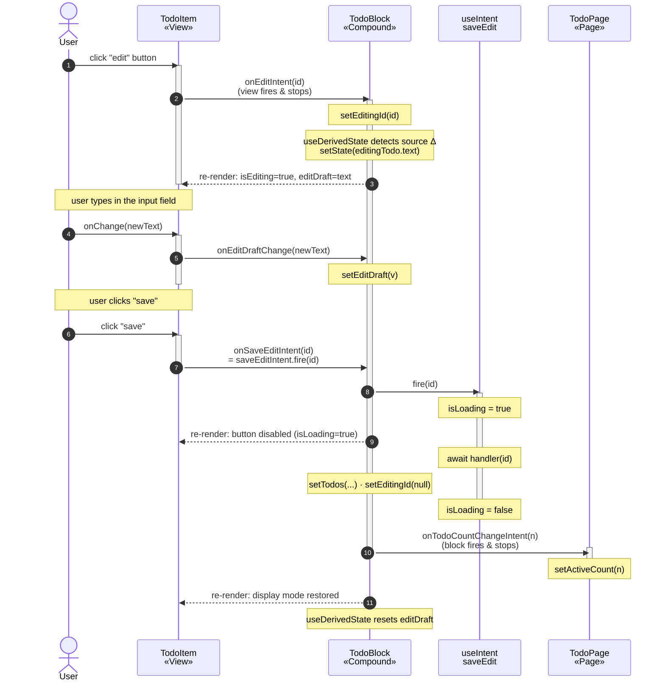

> **Key Takeaways**
> - **Applied Separation:** Demonstrates how orchestrators manage state while dumb presentational views consume derived models.
> - **Adapter Boundaries:** Illustrates how external third-party tools (like code editors or chart engines) are isolated behind translation wrappers.
> - **Visual Proof:** Includes architecture models and real-world UI design blueprints.

---

## 1. Complete Architecture Walkthrough

Below is a complete, production-ready example of a `UserProfileBlock` orchestrator following the Strict Blockiya pattern:

```tsx
import React, { useState, useEffect } from "react";
import { Box, Flex, Text, Button } from "@/shared/ui/primitives";
import { Dropdown } from "@/shared/ui/behavioral";
import { useIntent, useDerive, If } from "@/shared/blockiya-core";

// 1. Domain Types
export type UserRole = "admin" | "editor" | "viewer";

export interface User {
  id: number;
  name: string;
  email: string;
  role: UserRole;
}

// 2. Derived Presentation Type
export interface DisplayUser {
  fullName: string;
  email: string;
  roleBadge: string;
}

// 3. Pure Derivation Selector
export function deriveDisplayUser(user: User): DisplayUser {
  const badgeMap: Record<UserRole, string> = {
    admin: "Admin",
    editor: "Editor",
    viewer: "Viewer (Read Only)",
  };
  return {
    fullName: user.name,
    email: user.email,
    roleBadge: badgeMap[user.role],
  };
}

// 4. Dumb View: Display Mode
interface ProfileDisplayProps {
  user: DisplayUser;
  onEditIntent: () => void;
}

export function ProfileDisplayView({ user, onEditIntent }: ProfileDisplayProps) {
  return (
    <Flex direction="column" gap="md">
      <Text variant="heading">{user.fullName}</Text>
      <Text variant="muted">{user.email}</Text>
      <Text variant="badge">{user.roleBadge}</Text>
      <Button variant="secondary" onClick={onEditIntent}>
        Edit Profile
      </Button>
    </Flex>
  );
}

// 5. Dumb View: Edit Mode
interface ProfileEditProps {
  draft: User;
  isSaving: boolean;
  onChange: (field: keyof User, value: string) => void;
  onSave: () => void;
  onCancel: () => void;
}

export function ProfileEditView({
  draft,
  isSaving,
  onChange,
  onSave,
  onCancel,
}: ProfileEditProps) {
  return (
    <Flex direction="column" gap="md">
      <input
        type="text"
        value={draft.name}
        onChange={(e) => onChange("name", e.target.value)}
      />
      <input
        type="email"
        value={draft.email}
        onChange={(e) => onChange("email", e.target.value)}
      />
      <Flex direction="row" gap="sm">
        <Button variant="primary" onClick={onSave} disabled={isSaving}>
          {isSaving ? "Saving..." : "Save Changes"}
        </Button>
        <Button variant="ghost" onClick={onCancel} disabled={isSaving}>
          Cancel
        </Button>
      </Flex>
    </Flex>
  );
}

// 6. The Blockiya: Pure Orchestrator
interface UserProfileBlockProps {
  userId: number;
  onSaveIntent: (user: User) => void;
}

export function UserProfileBlock({ userId, onSaveIntent }: UserProfileBlockProps) {
  const [user, setUser] = useState<User | null>(null);
  const [draft, setDraft] = useState<User | null>(null);
  const [isEditing, setIsEditing] = useState(false);

  // Intent: Load User
  const { execute: loadUser, isLoading } = useIntent(async () => {
    const data = await fetch(`/api/users/${userId}`).then((r) => r.json());
    setUser(data);
  });

  // Intent: Save User
  const { execute: handleSave, isLoading: isSaving } = useIntent(async () => {
    if (!draft) return;
    const updated = await fetch(`/api/users/${draft.id}`, {
      method: "PUT",
      body: JSON.stringify(draft),
    }).then((r) => r.json());

    setUser(updated);
    setIsEditing(false);
    onSaveIntent(updated); // Announce intent upward
  });

  useEffect(() => {
    loadUser();
  }, [userId]);

  const handleFieldChange = (field: keyof User, value: string) => {
    setDraft((prev) => (prev ? { ...prev, [field]: value } : prev));
  };

  const startEditing = () => {
    setDraft(user);
    setIsEditing(true);
  };

  const cancelEditing = () => {
    setDraft(null);
    setIsEditing(false);
  };

  if (isLoading || !user) {
    return <Text variant="muted">Loading profile...</Text>;
  }

  const displayUser = deriveDisplayUser(user);

  return (
    <Box p="lg" radius="md" border>
      <If
        condition={isEditing && !!draft}
        fallback={
          <ProfileDisplayView
            user={displayUser}
            onEditIntent={startEditing}
          />
        }
      >
        <ProfileEditView
          draft={draft!}
          isSaving={isSaving}
          onChange={handleFieldChange}
          onSave={handleSave}
          onCancel={cancelEditing}
        />
      </If>
    </Box>
  );
}
```

---

## 2. The Third-Party Adapter Pattern

When integrating tools that require lifecycle hooks, canvas manipulation, or imperative APIs (such as CodeMirror, Monaco, or Chart.js), create an **Adapter**:

```tsx
import React, { useEffect, useRef } from "react";
import { EditorView, basicSetup } from "codemirror";
import { Box } from "@/shared/ui/primitives";

interface CodeEditorAdapterProps {
  value: string;
  onChange: (value: string) => void;
  height?: string;
}

export function CodeEditorAdapter({
  value,
  onChange,
  height = "300px",
}: CodeEditorAdapterProps) {
  const containerRef = useRef<HTMLDivElement>(null);
  const viewRef = useRef<EditorView | null>(null);

  useEffect(() => {
    if (!containerRef.current) return;

    const view = new EditorView({
      doc: value,
      extensions: [
        basicSetup,
        EditorView.updateListener.of((update) => {
          if (update.docChanged) {
            onChange(update.state.doc.toString()); // Event translation
          }
        }),
      ],
      parent: containerRef.current,
    });

    viewRef.current = view;

    return () => {
      view.destroy(); // Lifecycle management
    };
  }, []);

  return <Box ref={containerRef} height={height} />;
}
```

---

## 3. Sequence Architecture: The Intent Lifecycle

The following sequence diagram recreates the complete lifecycle of a user interaction in the Blockiya pattern (from editing a todo item, to firing intents, managing async execution via `useIntent`, and notifying the parent route):



### Key Architectural Phases Illustrated:
1. **Unidirectional Intent Notification (Steps 1–2):** The presentational view `TodoItem` captures user gestures and immediately forwards an intent (`onEditIntent(id)`). The view has zero knowledge of API routes or domain models; it fires and stops.
2. **Derived State Synchronization (Steps 3–5):** `TodoBlock` receives the intent, updates its local `editingId`, and synchronizes the draft text via `useDerivedState`.
3. **Controlled Input Flow (Steps 6–8):** Keystrokes pass through `onChange` to `TodoBlock` as a controlled draft update.
4. **Async Lifecycle Encapsulation (Steps 9–14):** `TodoBlock` triggers `saveEditIntent.fire(id)`. `useIntent` seamlessly manages `isLoading = true`, coordinates the async mutation handler, and flips back to `false` without manual boolean boilerplate.
5. **Caller Escalation (Steps 15–16):** Upon completing the internal mutation, `TodoBlock` notifies `TodoPage` of count changes (`onTodoCountChangeIntent(n)`), strictly maintaining layer boundaries.
