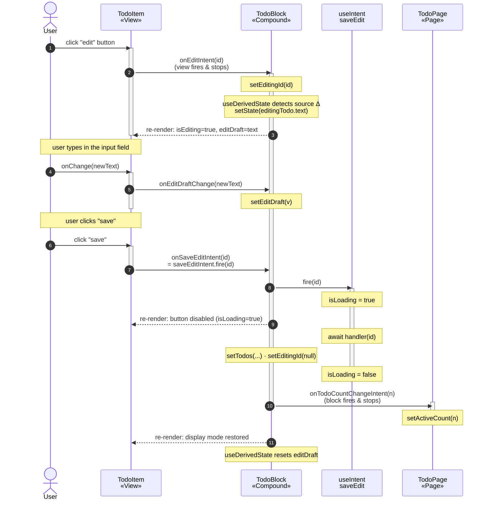

> **Key Takeaways**
> - **Applied Separation:** The orchestrator owns state and talks to data **only through the queries layer**; presentational views consume derived models and fire intents upward.
> - **Fire and Stop, Proven End-to-End:** The Blockiya never confirms, never navigates, never toasts—the page wiring shows exactly where those decisions land.
> - **Adapter Boundaries:** External tools (code editors, chart engines, avatar libraries) are isolated behind translation wrappers that own tokens, events, and lifecycle.

---

## 1. The Scenario

A profile fragment that loads a user, offers edit and delete, and reports outcomes upward. Every rule in [the main chapter](./index.md) applies; the compliance-critical spots are marked in comments.

### Types, deriver, and the queries layer

Data reaches the Blockiya **only** through hooks—raw `fetch()` inside a Blockiya is the violation the queries layer exists to prevent:

```tsx
// entities/user.ts
export type User = { id: number; name: string; email: string; role: "admin" | "editor" | "viewer" };

// Derived view type — presentational children never see raw User
export type DisplayUser = { fullName: string; email: string; roleBadge: string };

// Module-scope deriver: pure, unit-testable, stable reference
export function deriveDisplayUser(user: User): DisplayUser {
  const badge = { admin: "Admin", editor: "Editor", viewer: "Viewer (read only)" } as const;
  return { fullName: user.name, email: user.email, roleBadge: badge[user.role] };
}
```

```tsx
// features/users/queries/useUser.ts  — the ONLY place HTTP lives
import { useQuery, useMutation } from "@tanstack/react-query"; // e.g. — any server-state layer works

export const useUser = (id: number) =>
  useQuery({ queryKey: ["user", id], queryFn: () => api.get<User>(`/users/${id}`) });

export const useSaveUser = () =>
  useMutation({ mutationFn: (u: User) => api.put<User>(`/users/${u.id}`, u) });
```

### Presentational children (dumb views)

No state, no data calls, derived props in, intents out:

```tsx
// children/ProfileDisplayView.tsx
import { Box, Flex, Text, Button } from "@/shared/ui/primitives";
import { Dropdown } from "@/shared/ui/behavioral";       // compound — owns isOpen internally
import { UserAvatarAdapter } from "@/adapters/user-avatar/UserAvatarAdapter";
import type { DisplayUser } from "../../entities/user";

type Props = {
  user: DisplayUser;                 // derived — this view cannot know UserRole exists
  onEditIntent: () => void;
  onDeleteIntent: () => void;
};

export function ProfileDisplayView({ user, onEditIntent, onDeleteIntent }: Props) {
  return (
    <Flex direction="column" gap="md">
      <Flex align="center" gap="md">
        {/* adapter: this view has no idea which library renders the avatar */}
        <UserAvatarAdapter name={user.fullName} size="lg" />
        <Flex direction="column" gap="xs">
          <Text variant="heading">{user.fullName}</Text>
          <Text variant="muted">{user.email}</Text>
        </Flex>
      </Flex>
      <Box>
        <Text variant="label">Role</Text>
        <Text>{user.roleBadge}</Text>
      </Box>
      <Dropdown>
        <Dropdown.Trigger><Button variant="secondary">Actions</Button></Dropdown.Trigger>
        <Dropdown.Content>
          <Dropdown.Item onSelect={onEditIntent}>Edit profile</Dropdown.Item>
          <Dropdown.Item onSelect={onDeleteIntent} variant="danger">Delete account</Dropdown.Item>
        </Dropdown.Content>
      </Dropdown>
    </Flex>
  );
}
```

### The Blockiya (Strict, compliant)

```tsx
// features/users/blockiyas/UserProfileBlock/index.tsx
import { Box, Text } from "@/shared/ui/primitives";
import { If, useIntent, useDerivedState } from "@/shared/blockiya-core";
import { useUser, useSaveUser } from "../../queries/useUser";
import { deriveDisplayUser } from "../../entities/user";
import { ProfileDisplayView } from "./children/ProfileDisplayView";
import { ProfileEditView } from "./children/ProfileEditView";
import type { User } from "../../entities/user";

type Props = {
  userId: number;
  onSaveIntent: (user: User) => void;    // 3 props in, 2 intents out — inside the 3–7 ceiling
  onDeleteIntent: (userId: number) => void;
};

export function UserProfileBlock({ userId, onSaveIntent, onDeleteIntent }: Props) {
  // Rule: data via hooks, never inline fetch
  const { data: user, isPending, isError } = useUser(userId);
  const save = useSaveUser();

  // Draft = editable state seeded from the server, auto-resetting when
  // the source reference changes — useDerivedState, not hand-rolled effect pairs
  const [draft, setDraft] = useDerivedState(user ?? null, (u) => (u ? { ...u } : null));

  // Rule: async lifecycle owned by useIntent — no manual isLoading/error useState
  const saveIntent = useIntent(async () => {
    if (!draft) return;
    const saved = await save.mutateAsync(draft);
    setDraft(null);                       // leaves edit mode (parent refetch reseeds)
    onSaveIntent(saved);                  // fire upward — job ends HERE
  });

  if (isPending) return <Text variant="muted">Loading profile…</Text>;
  if (isError)   return <Text variant="danger">Could not load user.</Text>;

  const isEditing = draft !== null;

  return (
    <Box p="lg" radius="md" border>
      {/* Rule: zero styling in the Blockiya — Box/Text/Dropdown only */}
      <If condition={isEditing && draft} fallback={
        <ProfileDisplayView
          user={deriveDisplayUser(user!)}          // derive before you pass
          onEditIntent={() => setDraft({ ...user! })}
          onDeleteIntent={() => onDeleteIntent(userId)}
        />
      }>
        <ProfileEditView
          draft={draft!}
          isSaving={saveIntent.isLoading}
          onChange={(field, value) =>
            setDraft((prev) => prev && { ...prev, [field]: value })}
          onSaveIntent={() => saveIntent.fire()}
          onCancelIntent={() => setDraft(null)}
        />
      </If>
    </Box>
  );
}
```

> [!WARNING]
> Notice what the Blockiya does **not** contain: no confirmation dialog, no `navigate()`, no toast call, no refresh of sibling lists. The save handler fires `onSaveIntent` and stops. Those decisions belong one layer up.

### The Page — where post-intent decisions live

```tsx
// features/users/routes/user.page.tsx
export default function UserPage() {
  const [pendingDelete, setPendingDelete] = useState<number | null>(null);

  return (
    <>
      <UserProfileBlock
        userId={Number(params.id)}
        onSaveIntent={() => toast.push({ message: "Profile saved" })}   // page decides: toast
        onDeleteIntent={(id) => setPendingDelete(id)}                   // page decides: confirm first
      />

      <ConfirmDialog
        open={pendingDelete !== null}
        onConfirm={async () => {
          await api.deleteUser(pendingDelete);
          setPendingDelete(null);
          navigate("/users");                                            // and navigation
        }}
        onCancel={() => setPendingDelete(null)}
      />
    </>
  );
}
```

The delete intent crossed one boundary upward and the Blockiya forgot it ever happened. The page— which owns routing and dialogs—turned the intent into UX.

---

## 2. The Third-Party Adapter Pattern

When integrating tools that require lifecycle hooks, canvas manipulation, or imperative APIs (such as CodeMirror, Monaco, or Chart.js), create an **Adapter** that owns exactly three jobs—token translation, event translation, lifecycle:

```tsx
import React, { useEffect, useRef } from "react";
import { EditorView, basicSetup } from "codemirror";
import { Box } from "@/shared/ui/primitives";

interface CodeEditorAdapterProps {
  value: string;
  onChange: (value: string) => void;
  height?: string;
}

export function CodeEditorAdapter({
  value,
  onChange,
  height = "300px",
}: CodeEditorAdapterProps) {
  const containerRef = useRef<HTMLDivElement>(null);
  const viewRef = useRef<EditorView | null>(null);

  useEffect(() => {
    if (!containerRef.current) return;

    const view = new EditorView({
      doc: value,
      extensions: [
        basicSetup,
        EditorView.updateListener.of((update) => {
          if (update.docChanged) {
            onChange(update.state.doc.toString()); // Event translation
          }
        }),
      ],
      parent: containerRef.current,
    });

    viewRef.current = view;

    return () => {
      view.destroy(); // Lifecycle management
    };
  }, []);

  return <Box ref={containerRef} height={height} />;
}
```

A Blockiya importing this adapter sees `value`, `onChange`, `height`—it cannot tell whether CodeMirror, Monaco, or a hand-rolled textarea answers behind the curtain. Adapters live in their own top-level `adapters/` folder: an adapter is not a feature concern.

---

## 3. Sequence Architecture: The Intent Lifecycle

The following sequence diagram recreates the complete lifecycle of a user interaction in the Blockiya pattern (from editing a todo item, to firing intents, managing async execution via `useIntent`, and notifying the parent route):



### Key Architectural Phases Illustrated:
1. **Unidirectional Intent Notification (Steps 1–2):** The presentational view `TodoItem` captures user gestures and immediately forwards an intent (`onEditIntent(id)`). The view has zero knowledge of API routes or domain models; it fires and stops.
2. **Derived State Synchronization (Steps 3–5):** `TodoBlock` receives the intent, updates its local `editingId`, and synchronizes the draft text via `useDerivedState`.
3. **Controlled Input Flow (Steps 6–8):** Keystrokes pass through `onChange` to `TodoBlock` as a controlled draft update.
4. **Async Lifecycle Encapsulation (Steps 9–14):** `TodoBlock` triggers `saveEditIntent.fire(id)`. `useIntent` seamlessly manages `isLoading = true`, coordinates the async mutation handler, and flips back to `false` without manual boolean boilerplate.
5. **Caller Escalation (Steps 15–16):** Upon completing the internal mutation, `TodoBlock` notifies `TodoPage` of count changes (`onTodoCountChangeIntent(n)`), strictly maintaining layer boundaries.

---

## 4. Same Scenario, Other Frameworks

This walkthrough is the canonical React/TypeScript expression—not the only one. The [cross-framework chapter](./cross-framework.md) rebuilds the identical scenario in Vue 3 composables and .NET MAUI C#, layer for layer.
