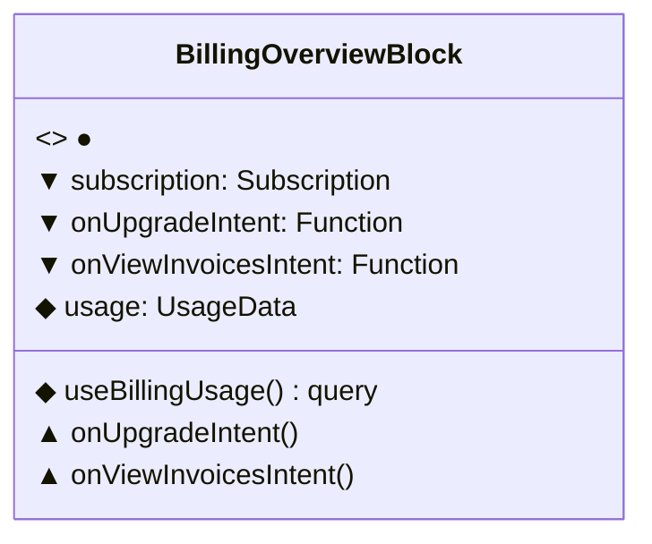
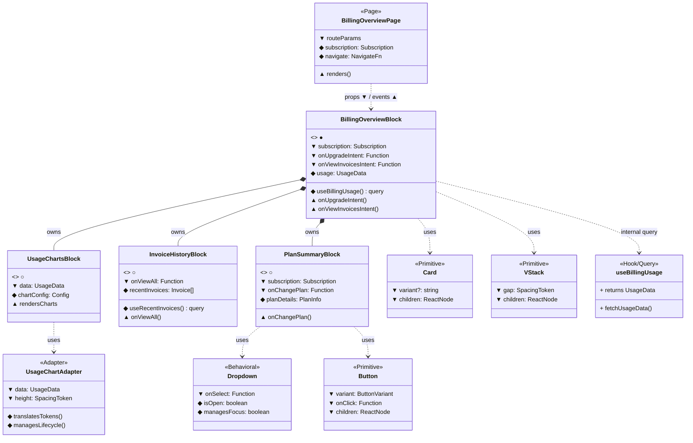

> **Key Takeaways**
> - **Visual Uniformity:** Provides a standardized, tool-agnostic visual language for frontend engineering teams—applicable in Mermaid, PlantUML, or whiteboards.
> - **Directional Rigor:** Distinguishes inputs from outputs using explicit directional indicators: props flowing downward (`▼`), internal hidden state (`◆`), and event intents rising upward (`▲`).
> - **Zero Ambiguity:** Eliminates the classic confusion between props, state, and event emissions in complex UI component trees.

---

## 1. Notation System Overview

As frontend systems grow, informal component boxes with vague arrows fail to communicate data flow and ownership. The **Blockiya UML Notation** adapts formal UML class diagram semantics specifically for component architectures.

### Core Principles

1. **Minimal Syntax:** Only essential markers that convey architecture are permitted.
2. **Directional Clarity:** Explicit flow markers show whether a property enters a block or an event exits it.
3. **Contextual Visibility:** Scope indicates export level relative to the parent feature.
4. **Standard Base:** Built on familiar UML class constructs.
5. **Tool Agnostic:** Native support in Mermaid, PlantUML, and pencil-and-paper diagrams.

---

## 2. Notation Reference Matrix

| Category | Purpose | Notation Symbols | Meaning |
|---|---|---|---|
| **Stereotypes** | Classify component architectural roles | `<<Page>>`, `<<Compound>>`, `<<Atomic>>`, `<<Primitive>>`, `<<Behavioral>>`, `<<Adapter>>`, `<<Utility>>` | Architectural classification |
| **Visibility** | Export and consumption scope | `●` Public `○` Private `◆` Internal | `●` Exported from feature `○` Internal to feature `◆` Hidden implementation |
| **Flow Direction** | Data and event trajectories | `▼` Inflow `▲` Outflow | `▼` Props entering block `▲` Events/Intents exiting block |
| **Relationships** | Component composition & dependencies | `*--` Strong Composition `..>` Dependency `⊙--` Provides Context `··>` Consumes Context | Structural linkages |

---

## 3. Block Structure Specification

Every Blockiya is diagrammed with four defined compartments:

| Section | Role | Contents |
|---|---|---|
| **Header** | Identity & Classification | Stereotype (`<<Compound>>`), Visibility marker (`●`), and Block Name |
| **Props (▼ Inflow)** | Inputs | All props passed down by the caller, including callbacks received |
| **Internal (◆ Hidden)** | Local State & Queries | Local state (`useState`), queries (`useQuery`), derivers (`useDerive`) |
| **Events (▲ Outflow)** | Outputs & Intents | Intents emitted upward (`onSaveIntent`) and callbacks invoked |

### Example Blockiya Definition

---

## 4. End-to-End Feature Diagram

Here is a full feature architecture expressed in Mermaid using the Blockiya UML specification:

---

## 5. Summary Cheat Sheet

| Symbol | Meaning | Example Context |
|---|---|---|
| `<<Page>>` | Route orchestrator | Top of the screen tree |
| `<<Compound>>` | Multi-block coordinator | Container holding 2–5 atomic blocks |
| `<<Atomic>>` | Leaf-level domain block | Self-contained single-concern block |
| `<<Primitive>>` | Non-behavioral visual element | `Box`, `Flex`, `Text`, `Button` |
| `<<Behavioral>>` | Interactive compound component | `Dropdown`, `Modal`, `Accordion` |
| `<<Adapter>>` | Boundary adapter | Wraps chart, editor, or canvas libraries |
| `<<Utility>>` | Structural logic helper | `If`, `For`, `useIntent`, `useDerive` |
| `*--` | Strong composition (owns) | Parent Blockiya instantiates child block |
| `..>` | Dependency usage | Component imports or consumes primitive/adapter |
| `⊙--` | Provides Context | Blockiya provides a scoped Context Object |
| `··>` | Consumes Context | Child component reads scoped Context Object |

