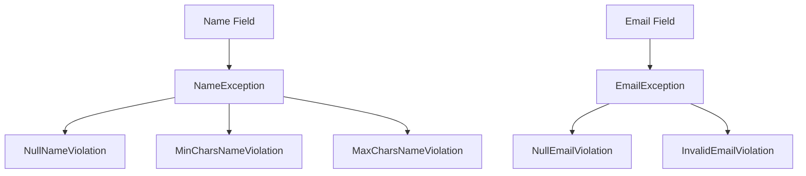

# Error as Truth

## 1. Introduction

**Error as Truth** is a software engineering and user experience philosophy that treats errors as first-class citizens in application design.

Errors are often treated as secondary concerns. Developers invest considerable effort in successful user journeys, while failure scenarios are frequently handled through generic messages, abstract exceptions, or overly simplified error handling.

This creates a gap between what the application actually knows and what it communicates to its users.

An application might know exactly why an operation failed, yet display only:

> *"Something went wrong."*

This is a failure of communication.

The central idea behind Error as Truth is:

> Every distinct failure condition deserves its own explicit error identity and meaningful explanation. Never collapse different truths into one generalized error.

The objective is to reduce uncertainty, improve user experience, minimize unnecessary support interactions, and help users recover without leaving the application.

---

## 2. Core Philosophy

Errors should be among the most carefully designed parts of an application.

When something goes wrong, the application should communicate the most accurate and relevant information available. An error should not merely indicate failure; it should explain what happened, why it happened, its impact, and how the user can recover.

### Errors are part of the user journey

A user journey does not end when an operation fails. An error is simply another state in that journey. It should provide a clear path toward recovery whenever possible. The application should never force users to investigate problems that the application already understands.

### Errors are a UX responsibility

Bad error handling creates unnecessary stress, confusion, and support requests. Good error handling helps users understand their situation and resolve problems independently, without friction or guessing.

---

## 3. The Field–Error–Violation Relationship

This is the central architectural model of Error as Truth. Three distinct concepts establish the ownership structure:

- **Field:** The application field or input to which an error belongs.
- **Error:** A specific error identity associated with a field.
- **Violation:** A specific condition that causes that error to occur.


### 3.1. Relationship Rules

**Field → Error**
1. Every Error must belong to exactly one Field.
2. Different Fields should have their own Error identities.
3. Similar failure conditions in different Fields do not automatically justify sharing an Error.

**Error → Violation**
1. Every Error must have at least one Violation.
2. Every Violation must belong to exactly one Error.
3. An Error can own multiple Violations.
4. A Violation must never be shared between multiple Errors.
5. Every distinct failure condition should have its own identifiable Violation.

### 3.2. Example

Consider an e-learning platform that collects a user's name and email address:

```text
Name Field
└── NameException
    ├── NullNameViolation
    ├── MinCharsNameViolation
    └── MaxCharsNameViolation

Email Field
└── EmailException
    ├── NullEmailViolation
    └── InvalidEmailViolation
```

The structure makes ownership explicit. `NullNameViolation` belongs to `NameException`, which belongs to the Name Field. Likewise, `NullEmailViolation` belongs to `EmailException`, which belongs to the Email Field.

Even though both violations describe a missing value, they remain independent.

### 3.3. Relationship Diagram



The ownership structure remains predictable, modular, and unambiguous.

---

## 4. Intentional Duplication

Error as Truth deliberately accepts some duplication.

Consider two fields:
- Name cannot be null.
- Email cannot be null.

Both represent a similar validation condition. A traditional instinct might attempt to eliminate duplication by introducing a shared `NullValueViolation`.

However, this introduces ambiguity:
- Which Field caused the violation?
- Which Error owns it?
- Which user-facing message should be displayed?
- Which recovery behavior should be triggered?

The system now needs additional mapping logic to reconstruct information that was already explicit at the point of failure.

Instead, we define:

```text
NameException
└── NullNameViolation

EmailException
└── NullEmailViolation
```

This is intentional duplication.

> **The Principle:** Clarity of ownership is more valuable than eliminating every instance of duplication.

Duplication is acceptable when it simplifies the architecture, makes ownership explicit, and reduces coupling. This does not mean all duplication is desirable: reusable mechanics and validation helpers are encouraged when they simplify implementation without stripping the identity or ownership of individual errors.

---

## 5. Error Identity and Communication

Every distinct violation should have its own identity and message.

| Violation | Message |
|---|---|
| `NullNameViolation` | Please enter your name. |
| `MinCharsNameViolation` | Name must contain at least 3 characters. |
| `MaxCharsNameViolation` | Name cannot exceed 50 characters. |
| `NullEmailViolation` | Please enter your email. |
| `InvalidEmailViolation` | Please enter a valid email address. |

Different violations must not be collapsed into generic messages such as *"Invalid input."* The application already knows more than that, and it should communicate what it knows.

Three concerns should remain distinguishable:
- **Identity:** Identifies the exact violation.
- **Message:** Communicates the violation to its intended audience.
- **Handling:** Determines how the application responds and recovers.

---

## 6. Implementation Philosophy

Error as Truth is an architectural principle, not an object-oriented programming requirement.

It does not require:
- Custom exception class hierarchies.
- Inheritance trees.
- A dedicated validation framework.
- Complicated error factories.
- Excessive abstraction layers.

It can be implemented cleanly using functional programming, plain objects, classes, or existing schema libraries.

> **Abstract the mechanics, not the meaning.**

### 6.1. Example Using Zod

Consider the Name and Email fields in a TypeScript application. First, define the error catalog:

```javascript
const Errors = {
  Name: {
    NULL: 'Please enter your name.',
    MIN_CHARS: 'Name must be at least 3 characters.',
    MAX_CHARS: 'Name cannot exceed 50 characters.',
  },
  Email: {
    NULL: 'Please enter your email.',
    INVALID: 'Please enter a valid email address.',
  },
};
```

Then use them directly in schema definitions:

```javascript
import { z } from 'zod';

const nameSchema = z
  .string({
    error: (issue) =>
      issue.input == null
        ? Errors.Name.NULL
        : 'Name must be a string.',
  })
  .min(3, Errors.Name.MIN_CHARS)
  .max(50, Errors.Name.MAX_CHARS);

const emailSchema = z.string().email({
  message: Errors.Email.INVALID,
});
```

Zod remains responsible for validation mechanics, while error definitions preserve their intended meaning, ownership, and clarity.

---

## 7. Error Communication and Audience

The same underlying error may need different representations depending on its audience.


For example, when an email verification code expires:

- **User-facing message:** *"Your verification code has expired. Request a new code to continue."*
- **Developer-facing telemetry:**
  ```text
  VERIFICATION_CODE_EXPIRED
  HTTP 422
  verification_attempt_id: "va_9841f"
  ```
- **Support-facing explanation:** *"The submitted verification code expired. No account changes were made. The user can request a new code directly."*

All three describe the same event. Each audience receives the calibrated information needed to understand or resolve the situation without exposing sensitive internals or security details.

---

## 8. Error Recovery

Identifying an error is only half of the responsibility. The application should provide a concrete path to recovery:

| Violation | Recovery Action |
|---|---|
| `NullNameViolation` | Focus the name input automatically. |
| `MinCharsNameViolation` | Highlight the counter and explain the minimum length requirement. |
| `MaxCharsNameViolation` | Truncate cleanly or display the remaining character allowance. |
| `NullEmailViolation` | Focus the email input. |
| `InvalidEmailViolation` | Display the expected email structure with inline examples. |

Error handling should preserve user progress whenever possible. When in-app recovery is possible, users should never be redirected to external support channels.

---

## 9. Practical Simplicity

An important discipline within Error as Truth is knowing when to stop engineering the error system.

The error architecture exists to serve the application, not to become a vanity project:

> Serving a dish plate without the food is useless. Likewise, building an elaborate error architecture that does not meaningfully improve the application is pointless.

**Practical value comes before architectural sophistication.** A straightforward schema referencing explicit error definitions delivers far more value than an intricate custom exception framework.

---

## 10. Summary

1. **Explicitness over generalization:** Every distinct failure condition deserves its own identity.
2. **Field ownership:** Every Error belongs to exactly one Field.
3. **Violation ownership:** Every Violation belongs to exactly one Error.
4. **At least one violation:** Every Error must own at least one Violation.
5. **Acceptable duplication:** Similar violations in different Fields remain independently defined.
6. **Clarity over abstraction:** Avoid abstractions that obscure error ownership.
7. **Meaningful communication:** Every violation should have an appropriate explanation.
8. **Separation of concerns:** Error identity, messaging, validation, and recovery should remain distinguishable.
9. **User-centered recovery:** Errors should guide users toward resolving the problem in place.
10. **Audience awareness:** Present appropriate, calibrated information to users, developers, and support teams.

**Abstract the mechanics, not the meaning.**  
**Don't make the user investigate what your application already knows.**

