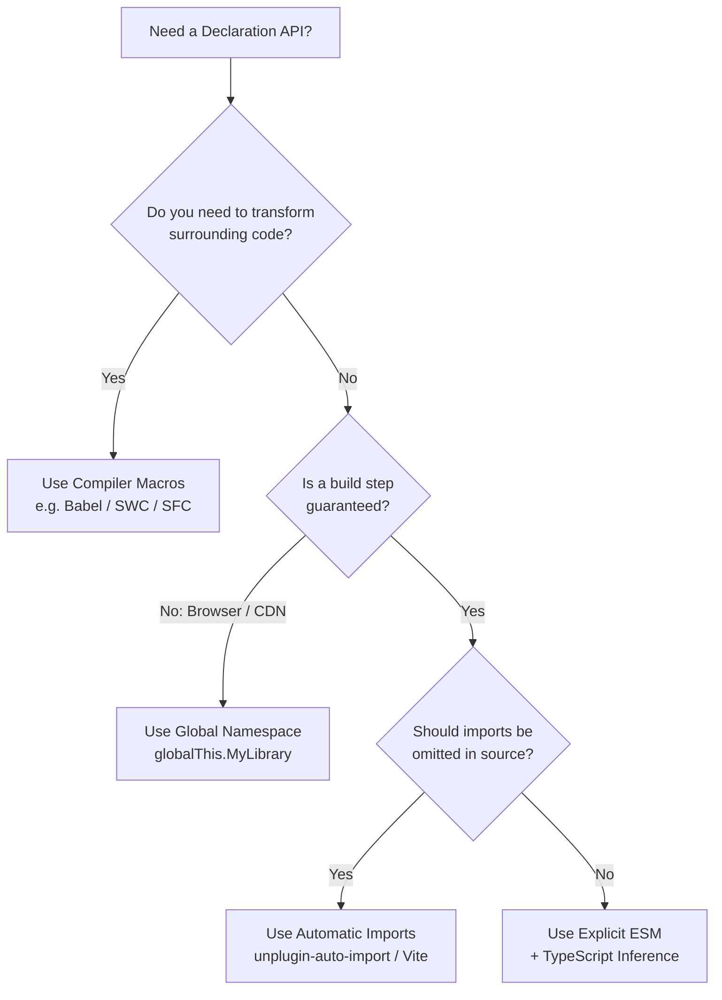

> **Key Takeaways**
> - **Import-free is a DX layer, not a language feature:** JavaScript has no built-in "import-free module" syntax. Libraries achieve this experience through distinct mechanisms—runtime globals, automatic import injection, compiler macros, IDE auto-imports, or application context.
> - **Separate API from delivery:** Your library's core logic (`defineConfig`, `definePlugin`) should live in a pure, framework-agnostic core module, while separate entry points (`/auto`, `/global`, `/vite`) handle how consumers access it.
> - **Compiler macros vs. ordinary functions:** Ordinary functions like Vite's `defineConfig()` execute at runtime (or provide pure TypeScript inference), whereas compiler macros like Vue's `defineProps()` are recognized at build time, transform surrounding code, and can disappear completely from the runtime bundle.
> - **Use ASTs, never regex:** When transforming source code to inject imports or expand macros, always use an Abstract Syntax Tree (Babel, SWC, Oxc, or `@vue/compiler-sfc`) paired with `MagicString` for source maps—string replacement breaks on comments, strings, and nested expressions.

---

## 1. Introduction: The Illusion of Effortless Declarations

Modern JavaScript frameworks and libraries frequently expose declaration APIs that let developers describe configurations, component properties, stores, and plugins through clean, declarative function calls:

```js
defineConfig({ /* Configuration */ })
defineProps({ /* Component properties */ })
defineStore('user', { /* Store definition */ })
defineNuxtConfig({ /* Framework configuration */ })
```

Notice what is missing: **explicit `import` statements**.

This raises a fundamental architectural question for library and framework authors: **how can a library expose functions that developers use without manually importing them?**

The answer is not tied to a single JavaScript feature. Instead, it spans multiple layers of the execution and build pipeline—from runtime global exposure and dependency injection to build-time AST transformations and compiler macros. Choosing the right mechanism requires understanding where each technique operates, what it costs in complexity and tree-shaking, and how to package multiple integration strategies without duplicating core logic.

---

## 2. Understanding the Fundamentals

Before comparing implementation techniques, it helps to separate three distinct concepts that are often conflated.

### 2.1 Declaration APIs

A **declaration API** provides a structured entry point for developers to *describe* intent rather than manually wiring up imperative logic:

```js
const config = defineConfig({
  name: 'Kabrha',
  version: '1.0.0',
})
```

At its simplest, `defineConfig` can be an identity function:

```js
export function defineConfig(options) {
  return options
}
```

Even as a pass-through, a declaration function earns its keep by enabling **TypeScript type inference**, **configuration validation**, **default value merging**, **runtime normalization**, **metadata generation**, and **plugin registration**. The function name itself does not grant these capabilities—its implementation and type signature do.

### 2.2 Import-Free APIs

Standard ECMAScript Modules (ESM) require explicit imports:

```js
import { defineConfig } from 'my-library'

const config = defineConfig({})
```

An **import-free API** removes the manual import from the consumer's source file:

```js
const config = defineConfig({})
```

Crucially, *import-free* does **not** automatically mean *global*. A build tool or compiler may inject the `import` statement behind the scenes before the code ever reaches a JavaScript engine.

### 2.3 Compiler Macros

A **compiler macro** is a special construct recognized by a compiler rather than executed as a normal JavaScript function. Inside Vue's `<script setup>`, for example, `defineProps()` is not imported because the Single-File Component (SFC) compiler intercepts it, extracts its arguments, and generates the corresponding component runtime code.

| Dimension | Ordinary Function | Compiler Macro |
| :--- | :--- | :--- |
| **Execution Phase** | Executes at runtime | Processed during compilation |
| **Runtime Presence** | Must be available at runtime | Can disappear after compilation |
| **Semantics** | Uses standard JavaScript semantics | Can introduce compiler-specific semantics |
| **Code Transformation** | Does not inherently transform its caller | Can transform surrounding code |

---

## 3. Implementation Approaches

There is no single best way to expose a declaration API. The eight approaches below represent a spectrum from zero-tooling ESM to full compiler integration.

### 3.1 Explicit Imports (The Traditional Baseline)

Standard ESM remains the most predictable baseline for general-purpose libraries:

```js
// Library
export function defineConfig(options) {
  return options
}

// Consumer
import { defineConfig } from 'my-library'

export default defineConfig({
  name: 'Kabrha',
})
```

- **Advantages:** Standard JavaScript behavior, explicit dependency graph, optimal tree-shaking, zero global pollution, and straightforward debugging.
- **Limitations:** Developers must write and maintain imports, which can feel verbose in configuration-heavy codebases.

### 3.2 Global Namespace Exposure

A library can attach its APIs to a single shared object on `globalThis`:

```js
// Library
globalThis.MyLibrary = {
  defineConfig(options) {
    return options
  },
  definePlugin(options) {
    return options
  },
}

// Consumer
const config = MyLibrary.defineConfig({
  name: 'Kabrha',
})
```

In browser environments, this works seamlessly via `<script>` tags:

```html
<script src="./my-library.js"></script>
<script>
  const config = MyLibrary.defineConfig({ name: 'Kabrha' })
</script>
```

Because `globalThis` resolves to the global object across browsers, Node.js, and Web Workers, it is ideal for CDN-distributed browser libraries and standalone scripts. However, it requires strict script load ordering, complicates tree-shaking, and makes test isolation harder.

### 3.3 Direct Global Function Injection

Instead of a namespace, a library can register functions directly on `globalThis`:

```js
// Library
globalThis.defineConfig = function (options) {
  return options
}

// Consumer
const config = defineConfig({ name: 'Kabrha' })
```

While this feels like a native language built-in, it carries a much higher risk of naming collisions with other libraries or future platform globals than a namespaced object (`MyLibrary.defineConfig`). Reserve direct global injection for small, standalone browser scripts where ergonomics outweigh module isolation.

### 3.4 Automatic Import Injection

Automatic import injection gives developers an import-free authoring experience while preserving standard ESM semantics in the compiled output.

```js
// Developer's original source
const config = defineConfig({ name: 'Kabrha' })

// Code generated by the build tool
import { defineConfig } from 'my-library'
const config = defineConfig({ name: 'Kabrha' })
```

#### How it works with Vite and `unplugin-auto-import`

A library can ship a Vite plugin (or instruct consumers to configure `unplugin-auto-import`) that scans source files for known identifiers and injects the missing imports:

```js
// vite.config.js
import { defineConfig } from 'vite'
import AutoImport from 'unplugin-auto-import/vite'

export default defineConfig({
  plugins: [
    AutoImport({
      imports: [
        {
          'my-library': [
            'defineConfig',
            'definePlugin',
            'defineSomething',
          ],
        },
      ],
    }),
  ],
})
```

- **Advantages:** Preserves normal module semantics, avoids global namespace pollution, supports tree-shaking, works with TypeScript, and can auto-generate `.d.ts` declaration files for editor autocomplete.
- **Limitations:** Requires build-tool integration, depends on accurate identifier detection, and can create ambiguity if two libraries export the same function name.

### 3.5 Compiler Macros

Compiler macros go beyond import convenience: they allow an API to reshape the surrounding code at build time.

```html
<!-- Vue <script setup> -->
<script setup>
const props = defineProps({
  title: String,
})
</script>
```

Conceptually, the SFC compiler transforms that macro into standard component options:

```js
export default {
  props: {
    title: String,
  },
  setup(__props) {
    const props = __props
    return { props }
  },
}
```

*(Note: This is a simplified illustration of the transformation, not Vue's exact internal output.)*

To build your own compiler macro (for example, `defineAwesome()` in a custom plugin), your compiler integration typically:
1. Parses the source file (e.g., via `@vue/compiler-sfc`, `@babel/parser`, SWC, or Oxc).
2. Locates calls to `defineAwesome()` in the AST.
3. Validates the macro's arguments and placement.
4. Generates the required runtime or structural code.
5. Removes or replaces the original macro call while preserving source maps via `MagicString`.

### 3.6 IDE-Assisted Auto-Imports

TypeScript's language service and modern editors can automatically insert `import { defineConfig } from 'my-library'` as soon as a developer types `defineConfig({})`. This requires zero runtime or build-plugin complexity from the library author—just clean ESM exports and accurate `.d.ts` type definitions. The trade-off is that the import still lives in the source file and depends on editor support.

### 3.7 Dependency Injection and Application Context

Frameworks like Vue (`provide` / `inject`) expose APIs through an initialized application context rather than globals or build plugins:

```js
// Provider
const app = createApp(App)
app.provide('myLibrary', { defineConfig })

// Consumer
const library = inject('myLibrary')
const config = library.defineConfig({ name: 'Kabrha' })
```

This guarantees application-level isolation and avoids global pollution, making it well-suited for plugins and shared runtime services—though it requires an active framework lifecycle.

### 3.8 Shared Setup Modules

A shared setup module centralizes imports in one local file (`setup.js`) and re-exports them:

```js
// setup.js
import { defineConfig, definePlugin } from 'my-library'
export { defineConfig, definePlugin }

// consumer.js
import { defineConfig } from './setup.js'
const config = defineConfig({})
```

This does not eliminate imports, but it reduces import sprawl in large applications without requiring any compiler or bundler plugins.

---

## 4. Real-World Framework and Library Examples

Similar-looking APIs often rely on completely different underlying mechanisms:

| Framework / Library | API | Underlying Mechanism |
| :--- | :--- | :--- |
| **Vue** | `defineProps()` | Compiler macro inside `<script setup>` |
| **Vue** | `defineEmits()` | Compiler macro inside `<script setup>` |
| **Nuxt** | `useFetch()` | Automatic import injection |
| **Nuxt** | `defineNuxtConfig()` | Configuration helper (auto-imported / typed) |
| **Svelte** | `$state()` | Compiler transformation (runes) |
| **Astro** | `Astro.props` | Framework-provided runtime context |
| **Pinia** | `defineStore()` | Ordinary runtime function |
| **Vite** | `defineConfig()` | Ordinary runtime helper for TypeScript inference |

Understanding this distinction prevents over-engineering: you do not need a custom compiler macro if a typed `defineConfig()` helper or an `unplugin-auto-import` preset solves the problem.

---

## 5. Understanding AST-Based Transformations

When you need to inject imports or transform macros, **never use string replacement** like `code.replace('defineSomething(', 'createInternalConfig(')`. Naive string matching accidentally mutates comments, string literals, unrelated identifiers, and nested expressions.

Instead, compilers parse source code into an **Abstract Syntax Tree (AST)**—a structured tree representing variable declarations, call expressions, identifiers, and object properties.


| Tool | Primary Responsibility |
| :--- | :--- |
| **Babel Parser** (`@babel/parser`) | Parse JavaScript and TypeScript into an AST |
| **Babel Traverse** (`@babel/traverse`) | Inspect and walk AST nodes |
| **Babel Generator** (`@babel/generator`) | Emit JavaScript code from a modified AST |
| **MagicString** | Apply surgical source edits while preserving source maps |
| **SWC** | High-speed Rust-based compiler and transformation infrastructure |
| **Oxc** | Modern, ultra-fast JavaScript/TypeScript parser and tooling |

---

## 6. Designing a Library With Multiple Integration Strategies

A well-architected library does not force every consumer into a single integration style. By separating the **core API** from the **delivery mechanism**, you can support explicit imports, automatic imports, and global browser scripts from one shared implementation.

```text
my-library/
├── src/
│   ├── core/
│   │   ├── define-config.js
│   │   ├── define-plugin.js
│   │   └── types.js
│   ├── runtime/
│   │   ├── create-config.js
│   │   └── initialize.js
│   ├── compiler/
│   │   ├── transform.js
│   │   └── macros.js
│   ├── integrations/
│   │   ├── vite.js
│   │   └── rollup.js
│   ├── auto/
│   │   └── index.js
│   ├── global/
│   │   └── index.js
│   └── index.js
├── package.json
└── tsconfig.json
```

Expose each strategy cleanly via `package.json` `exports`:

```json
{
  "exports": {
    ".": "./dist/index.js",
    "./auto": "./dist/auto.js",
    "./global": "./dist/global.js",
    "./vite": "./dist/vite.js"
  }
}
```

This lets consumers pick the exact integration that fits their stack:
- **Standard ESM:** `import { defineConfig } from 'my-library'`
- **Vite Auto-Import:** `plugins: [MyLibrary()]` from `'my-library/vite'`
- **Browser Global:** `<script src="my-library.global.js"></script>`

---

## 7. Comparison and Architectural Trade-offs

Use the matrices below to evaluate each mechanism against your project's constraints.

| Approach | Manual Imports in Source | Build Integration | Runtime Global |
| :--- | :--- | :--- | :--- |
| **Explicit ESM** | Required | No | No |
| **Global Namespace** | Not required | No | Yes |
| **Direct Global Function** | Not required | No | Yes |
| **Automatic Imports** | Not required | Yes | No |
| **Compiler Macros** | Not required | Yes | No |
| **IDE Auto-Import** | Automatically inserted | Not necessarily | No |
| **Dependency Injection** | Depends on context | No | No |
| **Shared Setup Module** | Required | No | No |

### Decision Matrix



| Requirement | Recommended Approach |
| :--- | :--- |
| **Standard reusable library** | Explicit ESM imports |
| **Simple browser / CDN API** | Global namespace (`globalThis.MyLibrary`) |
| **Minimal script-based API** | Direct global function |
| **Modern developer-friendly library** | Automatic imports (`unplugin-auto-import`) |
| **Custom framework-level syntax** | Compiler macros |
| **Editor convenience with zero runtime cost** | IDE auto-import + `.d.ts` |
| **Application-wide services** | Dependency injection |
| **Centralized app-specific imports** | Shared setup module |

---

## 8. Key Engineering Considerations

1. **Developer Experience (DX):** Removing imports only improves DX if it does not introduce brittle configuration or confusing error messages.
2. **Runtime vs. Build-Time Behavior:** Be explicit about whether a function executes at runtime (`useFetch`), provides type inference (`defineConfig`), or is compiled away (`defineProps`).
3. **TypeScript Support:** Even if your library is authored in JavaScript, generic type helpers elevate declaration APIs:
   ```ts
   interface LibraryConfig {
     name: string
     debug?: boolean
   }

   export function defineConfig<T extends LibraryConfig>(options: T): T {
     return options
   }
   ```
4. **Tree-Shaking:** Explicit ESM and automatic import injection preserve dead-code elimination; global registration often defeats it.
5. **Debugging and Source Maps:** Any AST transformation or macro expansion must preserve source maps so stack traces point to the developer's original code.
6. **Environment Compatibility:** Do not assume a Vite plugin or a browser `globalThis` script will behave identically across Node.js, Edge workers, and browsers.

---

## 9. Frequently Asked Questions

### Does an import-free API mean the function is global?
No. In modern toolchains like Nuxt or Vite with `unplugin-auto-import`, the source file has no `import` statement, but the bundler injects a standard ESM `import` during compilation. Nothing is added to `globalThis`.

### When should I build a compiler macro instead of using automatic imports?
Use automatic imports when the function still executes normally at runtime and you only want to save developers from typing `import` statements. Build a compiler macro only when you need to validate or transform the surrounding code structure at compile time (such as Vue's `defineProps()`).

### Why shouldn't I use `String.prototype.replace()` for code transformations?
String replacement cannot distinguish between a real function call and a match inside a comment, string literal, or nested expression. Always use an AST parser (Babel, SWC, or Oxc) paired with `MagicString` for reliable transformations and accurate source maps.

---

## 10. Recommended Learning Path & References

To master import-free API design, progress through these layers in order:
1. **JavaScript Modules:** ESM, imports, exports, and module resolution ([MDN — JavaScript Modules](https://developer.mozilla.org/en-US/docs/Web/JavaScript/Guide/Modules)).
2. **Global Objects:** `globalThis` and browser namespace management ([MDN — globalThis](https://developer.mozilla.org/en-US/docs/Web/JavaScript/Reference/Global_Objects/globalThis)).
3. **Build Tools:** Vite plugins and transformation pipelines ([Vite Plugin API](https://vite.dev/guide/api-plugin)).
4. **AST Fundamentals:** Parsing, traversal, and source maps ([Babel Parser](https://babeljs.io/docs/babel-parser), [MagicString](https://github.com/Rich-Harris/magic-string)).
5. **Automatic Imports:** Configuring and building presets ([unplugin-auto-import](https://github.com/unplugin/unplugin-auto-import)).
6. **Compiler Macros:** Studying production SFC compilation ([Vue — `<script setup>`](https://vuejs.org/api/sfc-script-setup.html), [Vue Compiler SFC](https://github.com/vuejs/core/tree/main/packages/compiler-sfc)).

---

## 11. Conclusion

An import-free API is not a special JavaScript language feature—it is a developer experience implemented through deliberate architectural choices.

The central principle is simple: **separate the public API from the mechanism that makes it available.** When your core library owns the functionality and thin integration layers handle ESM, auto-imports, globals, or compiler macros, you can deliver a clean, predictable, and maintainable experience across any JavaScript environment.

