Marketing pages and application shells want opposite things. A landing page wants every word already present in the first byte of the HTTP response; a trading dashboard wants nothing fetched until the user acts and never wants a full page reload again. A landing page wants analytics, chat widgets and A/B scripts loaded happily; a dashboard treats any third-party script inside its origin as a breach waiting to happen. Put both in one codebase and you get a compromise that satisfies neither: an app bundle bloated by marketing animations, and public pages whose content arrives only after JavaScript boots.

The split is the architecture this article is about. Not the slogan version — the actual specification: which host owns which route, how a session survives three subdomains, what a crawler that never runs JavaScript must find in the packet, how the brand stays visually identical across two design systems, and the dozen decisions people leave contradictory and then discover in production.

Throughout, the three hosts are `example.com` (public discovery and marketing), `app.example.com` (the interactive application) and `api.example.com` (the shared backend), with `assets.example.com` as an optional CDN. Where a concrete product helps, the worked example is an investment-simulator platform: public fund catalogue pages, public player profile pages, and a private workspace where authenticated users filter funds and simulate trades. The patterns are not specific to that product — swap fund for project, document, listing or lesson, and everything below still applies.

> **Key Takeaways**
> - Split the marketing surface from the application surface at the **subdomain** level, not the path level: you get independent release cycles, independent tech stacks, and third-party tracking scripts quarantined outside the origin that holds user data.
> - Sessions across subdomains belong in **`HttpOnly` cookies**, never in `localStorage`. `localStorage` is per-origin, unreachable from the sibling subdomain, and readable by any script in the page.
> - The hardened pattern is **two cookies**: a `__Host-session` secret locked to `app.example.com` alone, plus a non-sensitive `Domain=.example.com` hint cookie the edge can read to route logged-in visitors instantly.
> - Public pages must score on the **first packet**: complete prose, correct structured data, dynamic titles and Open Graph tags, with zero dependence on hydration. Social crawlers do not execute JavaScript — if it is not in the raw HTML, it does not exist for them.
> - Keep **one shared brand token source** imported by both surfaces, then let typography, radius and spacing differ per domain. That is exactly how Notion's `notion.com` and `app.notion.com` stay one brand on two unrelated CSS systems.

## The Two Surfaces Have Opposing Masters

Treating "make the app faster" and "make the site rank" as one project is why teams end up with either a slow marketing page or an unindexable one. The priorities are not merely different, they pull in opposite directions on every measurable axis.

| Dimension | Marketing surface `example.com` | Application surface `app.example.com` |
| :--- | :--- | :--- |
| **Metrics that matter** | FCP, LCP, crawlability, time-to-interactive | Interaction latency, memory footprint, state preservation across navigation |
| **Rendering** | Static generation or server rendering (Astro, Nuxt, Next.js in prerender mode) | Client-rendered SPA, frequently wrapped for mobile with Ionic/Capacitor |
| **Payload** | High-resolution art, brand typography, animation, third-party trackers | Smallest possible initial bundle, zero layout shift, instant layout |
| **Fonts** | Custom web fonts, deliberately | System fonts — zero font requests at startup |
| **Failure mode** | Thin HTML that ranks and previews badly | Heavy HTML that delays the product |

Separating them buys four concrete things.

**Independent release cycles.** Marketing publishes a landing page or rewrites copy without touching the app pipeline, without a rebuild of the SPA, and without risking in-app state. The deploy that changes a hero image is not the deploy that touches authentication.

**Reduced security scope.** Tag managers, chat widgets and analytics sit on `example.com`. Their blast radius is that origin. They cannot read anything inside `app.example.com`, because the browser keeps them in different origins and the cookies are scoped accordingly.

**One auth codebase instead of two.** Host every authentication screen — sign-in, sign-up, password reset — on `app.example.com`. The web app renders them, and the native build loads the same screens. Duplicated auth UI across web and mobile is where credential-handling bugs come from.

**Tech-stack autonomy.** Astro for the publishing surface and Vue for the workstation is not a compromise, it is the point. Each half takes the tool its job actually needs.

### The Four Guiding Principles

Every decision below traces back to one of four rules. They are worth stating before the specifics, because they are the tie-breakers.

1. **Zero unexpected cross-domain redirects.** A user already working inside the workspace must never be thrown out of `app.example.com` — or out of a native webview — by a link that quietly lands them on the marketing host.
2. **First-packet completeness.** Every public page delivers, in the very first HTTP response, complete prose, structured data, a dynamic title/meta hierarchy and Open Graph tags — without waiting on client-side hydration.
3. **Strict zero-leakage data boundaries.** Private data — balances, holdings, profit and loss, personal detail, linked guardian accounts — is isolated at the API boundary and never rendered or cached on a public route.
4. **Conversions preserve intent.** Public pages are entry points. When they hand a guest to the authenticated app, the intent travels with them: which fund, which action, which quantity.

### The Shape of the System

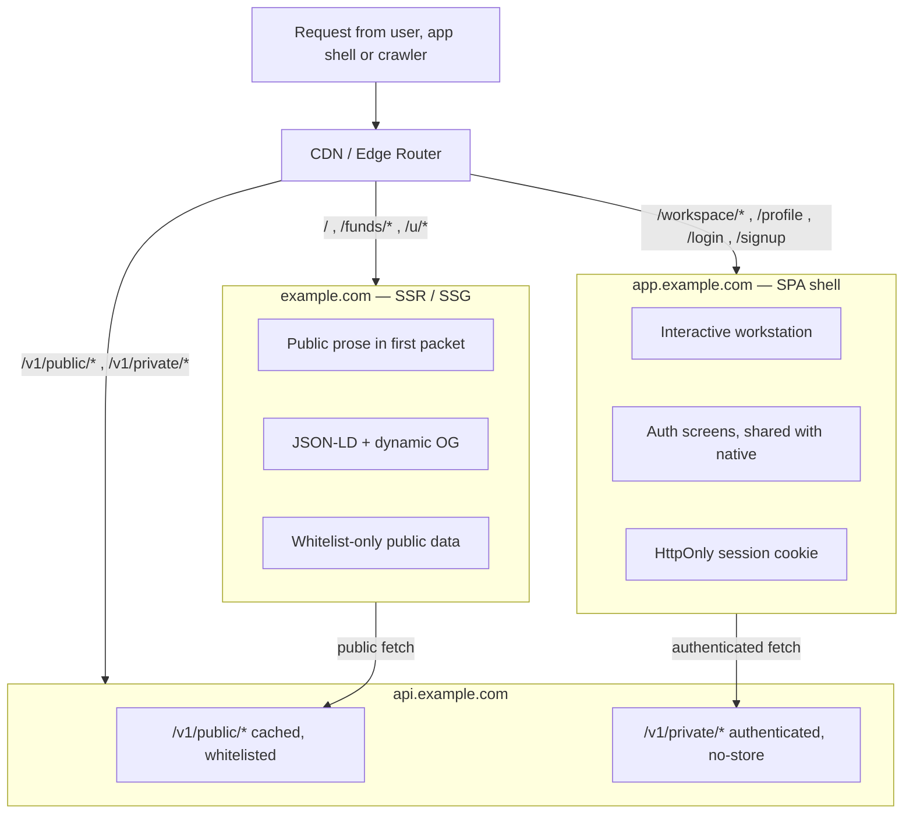

Read the diagram as a set of ownership boundaries, not a hosting recommendation. The single most important line is that nothing in the marketing subgraph has a path to private data, and nothing in the app subgraph is indexable.

## Subdomain, Subfolder, or Separate Domain

Three ways to separate the surfaces exist. Only one is cheap in every currency.

| Model | Example | Cost | Session handling | Authority | Brand coherence |
| :--- | :--- | :--- | :--- | :--- | :--- |
| **Subdomain split** | `example.com` + `app.example.com` | $0 beyond the root domain | Cookie `Domain=.example.com` covers both natively | Root domain accumulates authority for both | Unified |
| **Path split** | `example.com` + `example.com/app` | $0 | Trivially same-origin | One domain, but one bundle, one CSP, one deploy | Needs reverse-proxy gymnastics |
| **Separate domains** | `example.com` + `example.io` | Extra registration per TLD | Cross-origin token exchange, explicit and fragile | Authority split across two entities | Fragmented without redirects |

The path split keeps everything same-origin, which is exactly the problem: your CSP now has to permit the marketing stack and the application stack simultaneously, your bundle is one bundle, and your deploy is one deploy. Separate domains cost you authority and force a token exchange across an origin boundary, which is how "just pass the token in the URL" habits start.

**The subdomain split is the choice.** It gets cookie scoping for free from the browser, keeps domain authority on one root, and still gives you two independent codebases, two pipelines and two security contexts.

### DNS

```dns
;; Root domain — marketing
example.com.        IN  A      192.0.2.10        ; hosting target
www.example.com.    IN  CNAME  example.com.

;; Application subdomain
app.example.com.    IN  CNAME  cname.example-app-hosting.test.

;; Shared API subdomain
api.example.com.    IN  A      198.51.100.20
```

Every address and CNAME target above is a placeholder from [RFC 5737](https://www.rfc-editor.org/rfc/rfc5737) documentation space. Replace them with your real hosting values; do not copy these.

### Search Console

Register the **domain property** for `example.com` and verify it by DNS TXT record, rather than registering each subdomain as a separate URL-prefix property. The domain property aggregates all hosts under the root — `example.com`, `app.example.com`, `api.example.com` — into one view of indexing coverage, sitemap submissions and crawl diagnostics, and it is the only property type that authorises every subdomain at once. See Google's [Introduction to Search Console](https://search.google.com/search-console/about) and its [site-verification documentation](https://support.google.com/webmasters/answer/9008080) for the current property types.

## The Route Map: Which Host Owns Which Path

Ambiguity here is the root cause of most cross-domain bugs, so write it down before building. One route, one owner, one rendering engine, one indexing decision.

| Route | Host | Access | Indexing | Render engine |
| :--- | :--- | :--- | :--- | :--- |
| `/` | `example.com` | Public guest | `index, follow` | SSG |
| `/pricing`, `/privacy`, `/terms` | `example.com` | Public guest | `index, follow` | SSG |
| `/funds` | `example.com` | Public guest | `index, follow` | SSR |
| `/funds/[slug]` | `example.com` | Public guest | `index, follow` | SSR |
| `/u/[username]` | `example.com` | Public, read-only | `index, follow` | SSR |
| `/login`, `/signup` | `app.example.com` | Public | `index, follow` — deliberate exception | SPA + static head |
| `/profile` | `app.example.com` | Authenticated | `noindex` | SPA |
| `/workspace/*` | `app.example.com` | Authenticated | `noindex` | SPA |

Three observations that save arguments later.

Public legal and pricing pages belong on the marketing host even though they describe the product. Their job is to be found and cited, and that is the marketing host's job.

Auth screens belong on the **app** host, not the marketing host. They are the product's front door, they must be same-origin with the session they create, and the native build loads them. This is the one place where an application route is deliberately indexable, covered in the gateway-SEO section.

Everything inside `/workspace` is a private URL whose content is meaningless without a session. Indexing it would leak its existence at best.

## Route Bridging: Making Two Hosts Feel Like One Product

Users do not care which host owns a path. They type or click a URL and expect to be where they meant to be. **Route bridging** is a table of edge rules that makes that true: if a request arrives at the wrong origin for its path, the CDN sends it to the right one before any application code runs.

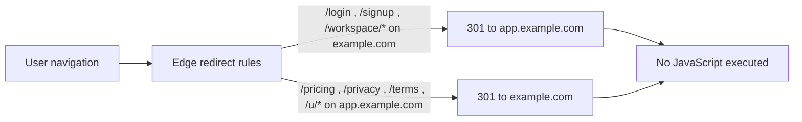

Do this at the edge — Cloudflare Redirect Rules, an Nginx map, or your host's equivalent — not in application code. An edge rule costs one request round-trip and zero bundle. The same logic written as a client-side check has to download and boot the SPA first, which is precisely the latency you split the domains to avoid.

| Origin | Requested path | Destination | Status | Purpose |
| :--- | :--- | :--- | :--- | :--- |
| `example.com` | `/login` | `app.example.com/login` | `301` | Auth lives with the session |
| `example.com` | `/signup` | `app.example.com/signup` | `301` | Registration lives with the session |
| `example.com` | `/workspace/*` | `app.example.com/workspace/*` | `301` | Private routes never render publicly |
| `app.example.com` | `/pricing` | `example.com/pricing` | `301` | Commercial pages served by SSR |
| `app.example.com` | `/privacy` | `example.com/privacy` | `301` | Compliance documents on the public host |
| `app.example.com` | `/terms` | `example.com/terms` | `301` | Compliance documents on the public host |
| `app.example.com` | `/u/:username` | `example.com/u/:username` | `301` | Public profiles belong to the crawler-visible host |

`301` versus `302` is a real decision, not a style preference. Per [RFC 9110 §15.4](https://www.rfc-editor.org/rfc/rfc9110#section-15.4), `301` is permanent and cacheable by default while `302` is temporary and not cacheable by default. Bridging is a permanent architectural fact, so `301` is right — with the consequence that a mistaken rule is remembered by browsers and CDN caches long after you fix it. Test bridging rules with `curl -I` and a cache-busting query before you ship them, and expect to purge caches when you change one.

### Sending Logged-In Visitors Straight to the App

Bridging fixes wrong-host paths. A separate rule handles the commoner case: a signed-in user landing on the marketing homepage because that is what they typed or bookmarked. Reading the marketing page, then clicking "Open app", is a wasted page load for someone who is already authenticated.

An edge middleware reads the non-sensitive hint cookie and answers with a `302` before the marketing document is ever built. Full code in the reference implementation section. It is a `302`, not a `301`, on purpose: the destination depends on session state that changes, and a permanently cached redirect would trap a signed-out visitor inside the app.

Note the distinction from principle one. "Zero unexpected cross-domain redirects" protects a user who is *already working inside* the app from being bounced out. An edge redirect on a *marketing* visit is expected, one-way, and cheap: no JavaScript, no DOM, one response header.

## Why `localStorage` Tokens Fall Apart Across Subdomains

Storing bearer tokens in `localStorage` or `sessionStorage` is the instinctive choice and the one that breaks hardest in a multi-subdomain design, for three separate reasons.

**Any script in the origin can read it.** `localStorage` has no access control beyond origin. A tag manager, a compromised npm dependency, a malicious comment rendered into the page — anything executing in that window can call `localStorage.getItem('access_token')` and post it wherever it likes. OWASP's [XSS prevention cheat sheet](https://cheatsheetseries.owasp.org/cheatsheets/Cross_Site_Scripting_Prevention_Cheat_Sheet.html) and [Session Management cheat sheet](https://cheatsheetseries.owasp.org/cheatsheets/Session_Management_Cheat_Sheet.html) treat this as the reason HTTP-only cookie storage is preferred for session tokens.

**It is not shared, and cannot be made shared.** Storage is partitioned by origin — scheme, host and port, with registrable-domain scoping as MDN describes in its [`Storage` API documentation](https://developer.mozilla.org/en-US/docs/Web/API/Storage) — so a document on `example.com` cannot read what `app.example.com` stored. There is no attribute that widens it the way `Domain=` widens a cookie. Teams discover this and reach for one of two repairs: putting the token in a URL (`app.example.com?token=eyJ...`), which lands the credential in server logs, browser history, referrer headers and shoulder-surfing range; or building a cross-origin `postMessage` bridge with a hidden iframe, which is a genuinely fragile thing to keep correct across two release cycles.

**It forces a flicker.** Nothing about auth state is knowable before the bundle runs. The browser must download the JavaScript, boot the application, read storage, evaluate the session and only then decide whether to redirect. The user watches an empty shell, then gets moved. With a cookie, the server already knows at request time.

## `HttpOnly` Cookies and the `Domain=` Scope

The browser solves cross-subdomain sessions natively, through one attribute on the `Set-Cookie` response header.

```http
HTTP/1.1 200 OK
Set-Cookie: session_id=s_9f8234a1b02d; Domain=.example.com; Path=/; HttpOnly; Secure; SameSite=Lax; Max-Age=2592000
```

| Attribute | Effect |
| :--- | :--- |
| `Domain=.example.com` | The cookie is sent to `example.com`, `app.example.com`, `api.example.com` and any future subdomain. The leading dot is historical and optional in modern parsers; the `Domain=` attribute itself is what widens scope beyond the exact host. |
| `HttpOnly` | `document.cookie` cannot see it. Script in the page cannot read or copy the session, which removes the primary XSS exfiltration path. |
| `Secure` | Transmitted over HTTPS only. |
| `SameSite=Lax` | Sent on top-level cross-site navigation (clicking a link into `app.example.com`), withheld on cross-site sub-resource requests and POSTs. The practical effect is CSRF resistance without breaking ordinary inbound links — see MDN on [`SameSite`](https://developer.mozilla.org/en-US/docs/Web/HTTP/Reference/Headers/Set-Cookie/SameSite) and [RFC 6265bis](https://datatracker.ietf.org/doc/html/draft-ietf-httpbis-rfc6265bis). |
| `Max-Age` | Lifetime in seconds. `2592000` is 30 days. |

Two things to get right immediately. The API is cross-origin to the app, so every web request that must carry the session needs `credentials: 'include'` on `fetch`, or `withCredentials: true` on Axios, and the API must answer with a specific `Access-Control-Allow-Origin` plus `Access-Control-Allow-Credentials: true`. A wildcard origin with credentials is rejected by the browser. And `Secure` is not optional decoration: without it the cookie crosses the wire in cleartext on any HTTP request.

## The Two-Cookie Architecture

A single wildcard cookie is convenient and slightly dangerous. `Domain=.example.com` means *every* subdomain can write to that jar. If one sibling host is insecure — a marketing microsite with an open redirect, a forgotten staging box, a status page with user-controlled content, which is what [cookie tossing](https://owasp.org/www-community/attacks/)" style attacks exploit — an attacker can plant or overwrite cookies on the parent domain and poison the application's view of the session.

The hardened pattern splits the two jobs into two cookies.

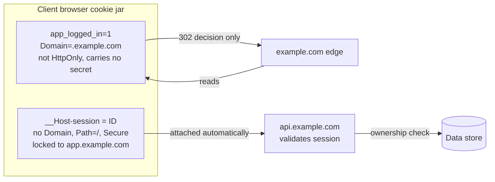

**The secret: `__Host-session`.** Issued with the `__Host-` name prefix, `Path=/`, `Secure`, and deliberately **no** `Domain` attribute. Per the cookie-prefix rules in [RFC 6265bis §4.1.2](https://datatracker.ietf.org/doc/html/draft-ietf-httpbis-rfc6265bis#section-4.1.2) and [MDN's `__Host-` description](https://developer.mozilla.org/en-US/docs/Web/HTTP/Reference/Headers/Set-Cookie), the prefix makes the browser reject any attempt to widen scope: no `Domain` allowed, `Path` must be `/`, `Secure` mandatory. The result is a session credential that exists only inside `app.example.com`. No sibling subdomain can read it, and no sibling subdomain can forge it.

**The hint: `app_logged_in`.** Issued with `Domain=.example.com`, `HttpOnly` off, value a boolean flag. It asserts one non-secret fact: this browser holds a session somewhere on the app host. The marketing edge reads it to decide a redirect and to swap a "Get started" button for an "Open app" one. If it is forged, the attacker gets a `302` to a login page; the API still requires the `__Host-session` cookie for anything real.

That is the whole trick: **share only what is harmless to share, and keep the credential host-locked.** The shared wildcard cookie carries a boolean; the unshared host-locked cookie carries the session.

### Where the Token Lives, by Runtime

| Runtime | Storage | Transmission |
| :--- | :--- | :--- |
| Web app (`app.example.com`) | `HttpOnly`, `Secure`, `SameSite=Lax` cookie | Automatic once `credentials: 'include'` is set |
| Native APK / IPA | Keychain (iOS) / Keystore or encrypted prefs (Android) | `Authorization: Bearer <token>` header |

Web and native are not the same problem. Keep this one line in the codebase where someone will read it: on the web, JavaScript must never hold the credential. On native, JavaScript is the only thing that can.

### The Web Flow, End to End

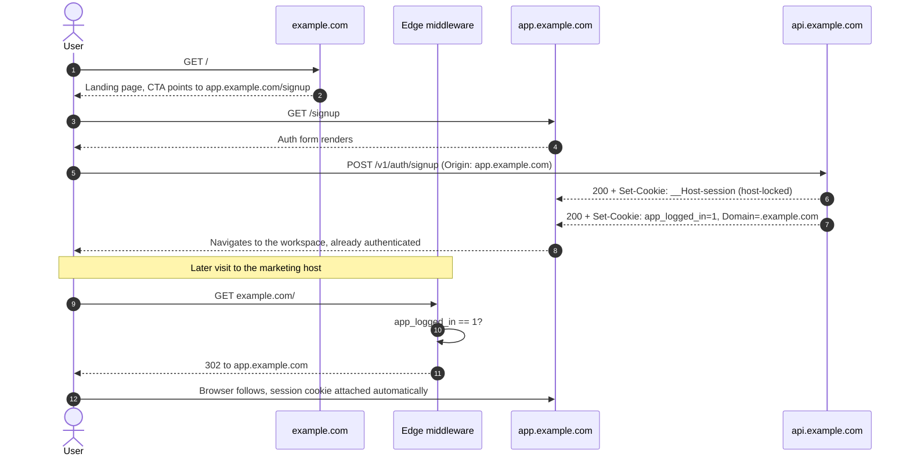

The credential never touches JavaScript on this path, which is the point. The server issues it, the browser stores it, the browser attaches it, and the application code only ever learns the *result* of authentication — never the token itself.

## Mobile Authentication with Ionic and Capacitor

A packaged app is not a browser tab, and the assumption breaks exactly where the cookie design lives.

In an Ionic or Capacitor build the web bundle is compiled into a native container that runs from a custom scheme — `capacitor://localhost` on iOS, `http://localhost` on Android. Cookie `Domain=` scoping is defined against hostnames, and `localhost` in a custom scheme is not a subdomain of `example.com`. A wildcard `.example.com` cookie is simply not part of that jar. The same-origin concept the marketing/app split relies on does not exist here in the form the web code assumes.

So the API branches on the client, and the client branches on the platform.

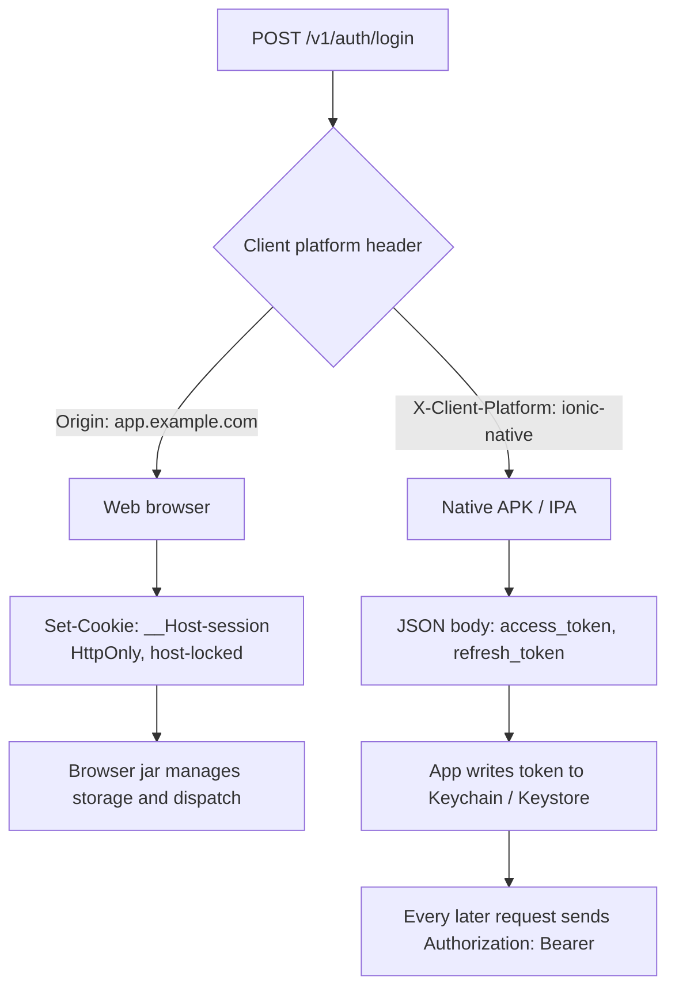

One codebase decides which branch it is on at runtime:

```typescript
// services/AuthService.ts — shipped to both web and native builds
import { Capacitor } from '@capacitor/core';
import { SecureStoragePlugin } from 'capacitor-secure-storage-plugin';

export interface AuthResponse {
  user: { id: string; email: string };
  access_token?: string; // present only for native clients
}

export class AuthService {
  private readonly apiBase = 'https://api.example.com/v1';

  async login(credentials: { email: string; password: string }): Promise<AuthResponse> {
    const isNative = Capacitor.isNativePlatform();

    const response = await fetch(`${this.apiBase}/auth/login`, {
      method: 'POST',
      headers: {
        'Content-Type': 'application/json',
        'X-Client-Platform': isNative ? 'ionic-native' : 'web-browser',
      },
      // Required on web so the browser will accept and store the HttpOnly cookie.
      credentials: 'include',
      body: JSON.stringify(credentials),
    });

    if (!response.ok) {
      const data = await response.json().catch(() => ({}));
      throw new Error(data.message ?? 'Authentication failed');
    }

    const data: AuthResponse = await response.json();

    if (isNative && data.access_token) {
      await SecureStoragePlugin.set({ key: 'app_bearer_token', value: data.access_token });
    }

    return data;
  }

  async fetchWithAuth(url: string, options: RequestInit = {}): Promise<Response> {
    const headers = new Headers(options.headers ?? {});

    if (Capacitor.isNativePlatform()) {
      const { value } = await SecureStoragePlugin.get({ key: 'app_bearer_token' }).catch(() => ({ value: null }));
      if (value) headers.set('Authorization', `Bearer ${value}`);
    }

    return fetch(url, { ...options, headers, credentials: 'include' });
  }
}

export const authService = new AuthService();
```

The `catch(() => ({ value: null }))` on read is not defensive noise. On a first run, after an OS restore, or after the user cleared app data, the key simply is not there, and a thrown exception from the storage plugin will abort the request wrapper.

### A Warning About Capacitor Preferences

`@capacitor/preferences` is the obvious place to put that token and it is the wrong one. Capacitor's own [Preferences API documentation](https://capacitorjs.com/docs/apis/preferences) describes plain key-value storage — `SharedPreferences` on Android, `UserDefaults` on iOS — and does not describe it as an encrypted vault. A token written there is a token in a plaintext app-private file.

For credentials, use storage backed by the platform's actual secrets facility: the iOS Keychain and the Android Keystore. `capacitor-secure-storage-plugin` is a community plugin that does exactly that; it is not part of the Capacitor core API surface, so pin the version and read its source before trusting it. Whatever you choose, verify the claim in the *current* documentation of the library you shipped, not in a blog post including this one.

### Authorization Code Flow with PKCE

The most robust native flow does not put the credential in your app at all. It hands login to the system browser, then trades a one-time code for tokens over a deep link.

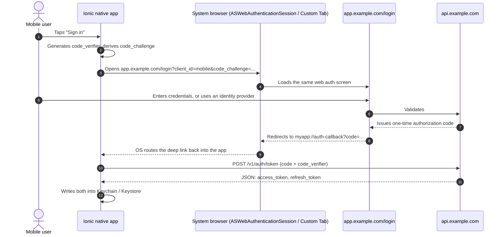

Why this is worth the extra plumbing: the password is typed into a browser your app cannot observe, so no webview in your process ever holds it; the code is single-use and short-lived; and PKCE binds the code to the client that started the flow, so intercepting the deep link is not enough to redeem the code. [RFC 7636](https://datatracker.ietf.org/doc/html/rfc7636) defines the challenge and verifier, and [BCP 190 / RFC 8252, *OAuth 2.0 for Native Apps*](https://datatracker.ietf.org/doc/html/rfc8252), is the authoritative guidance — including its requirement to use the **system browser rather than an embedded webview**, precisely because embedded webviews can read credentials and are routinely refused by identity providers.

The web auth screen at `app.example.com/login` is shared between the browser session and this native flow. Same URL, same form, one codebase — principle three from the decoupling argument, earning its keep.

### Telling the Server Which Runtime You Are

Callbacks and OAuth redirects go wrong when the server cannot tell a browser from a packaged app. Declare it in the link that starts the flow.

| Parameter | Value | Runtime | Behaviour |
| :--- | :--- | :--- | :--- |
| `platform` / `clientBuildTarget` | `web` | Browser at `app.example.com` | Stay in the browser session |
| `platform` / `clientBuildTarget` | `mobile_native` | Android APK / iOS IPA | Return via the app's custom scheme |
| `platform` / `clientBuildTarget` | `desktop` | Electron shell | Return via the desktop protocol handler |

```
https://app.example.com/login?lang=en&platform=web&clientBuildTarget=web&from=marketing
```

Pick one vocabulary for the web client — `web` or `client`, not both — and one transport for the platform signal. A header (`X-Client-Platform`), a different header (`X-Client-Type`), and a query parameter (`platform=mobile_native`) describing the same fact is three chances to disagree. See the decisions table.

## Synchronising Language, Theme and Session State Across Hosts

Language and theme are not session state. They are non-sensitive user preferences, and they must agree between the marketing host and the app host — a French user bounced from a French landing page into an English application experiences that as a bug, because it is one.

Two mechanisms, used together rather than as alternatives:

1. **Shared-domain cookies** carry durable preferences, readable by both hosts.
2. **Explicit URL parameters** carry in-the-moment context, readable before anything is loaded.

The cookie tells you what the user prefers. The parameter tells you what *this visit* needs. A request from a marketing page that was rendered in Arabic into a first app screen that reads only cookies is already too slow to be useful; the URL is the only context available at first paint.

### The Locale Resolution Ladder

When the app boots, resolve language once, in a strict order, and write the result back up the ladder.

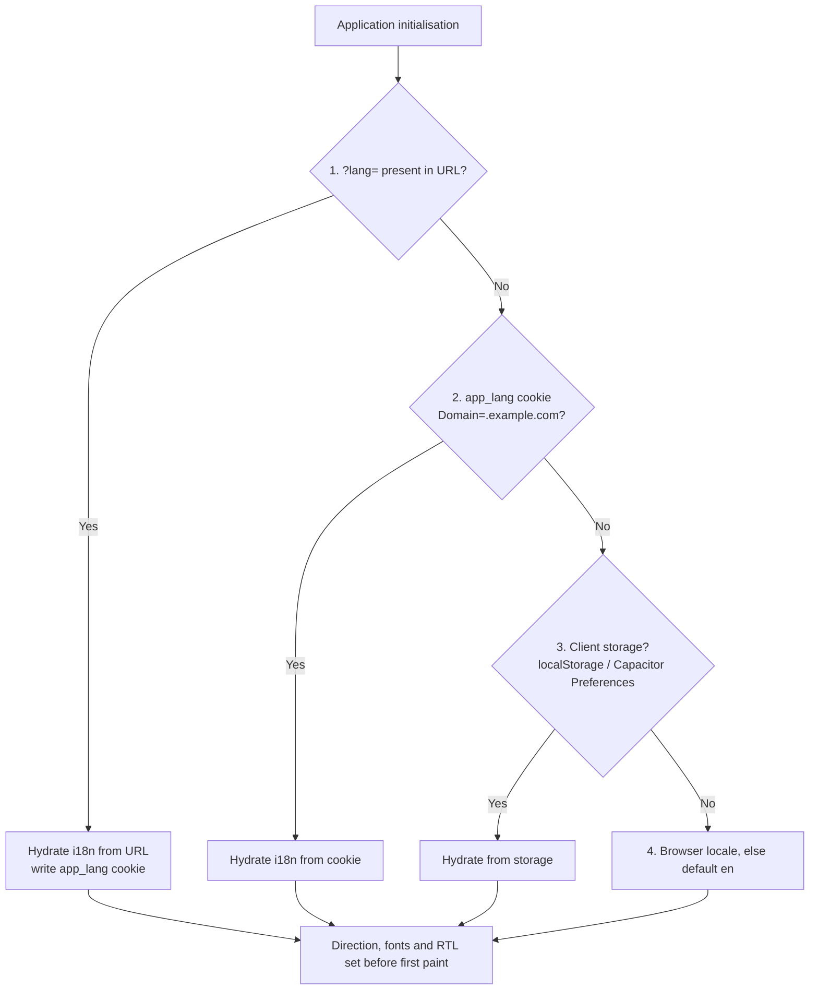

| Priority | Source | Why it sits here |
| :--- | :--- | :--- |
| 1 | URL query `?lang=` | Only source available before any storage read; wins, and is persisted upward |
| 2 | Shared cookie `app_lang` | Available to SSR on both hosts, so the server can render the right direction |
| 3 | Client storage | Survives on native, where cookies are awkward, but invisible to the server |
| 4 | Browser locale, then default | Last line of defence; the default is an explicit product decision |

Deterministic and documented matters more than which order you pick. An order nobody can predict turns every locale bug into an investigation.

### The Cross-Domain Parameter Vocabulary

| Parameter | Function |
| :--- | :--- |
| `lang` | First-packet locale. Guarantees correct hydration before the cookie is read or the app initialises |
| `clientBuildTarget` | Runtime target: web SPA, desktop shell, or native mobile. Prevents a deep link returning to a host that cannot open it |
| `from` | Visit provenance: `marketing`, `logout`, `email`, `invite`. Drives tailored banners and suppresses auto-login |
| `pathname` | Percent-encoded destination to resume after auth. Carries intent across the login boundary |
| `reason` | Why the session ended: `expired`, `reset`, `revoked`. Lets the login screen explain itself |

### Shared Preference Cookies

These are deliberately **not** `HttpOnly`: the SSR layer on `example.com` reads them to render the correct direction and theme, and the client writes them on change.

```javascript
// Language and theme: readable on both hosts, no secret involved.
document.cookie = "app_lang=en;   domain=.example.com; path=/; max-age=31536000; SameSite=Lax; Secure";
document.cookie = "app_theme=dark; domain=.example.com; path=/; max-age=31536000; SameSite=Lax; Secure";

// Non-sensitive presence signal, so example.com can show "Open app" instead of "Get started".
document.cookie = "app_session_active=true; domain=.example.com; path=/; max-age=2592000; SameSite=Lax; Secure";
```

| Cookie | Purpose | Lifetime |
| :--- | :--- | :--- |
| `app_lang` | Preferred language | 1 year |
| `app_theme` | Preferred theme | 1 year |
| `app_session_active` | Signals a session exists, for CTA text only | 30 days |

Every cookie written this way is visible to every subdomain and to every script on those subdomains. That is acceptable only because the values are harmless. The moment a shared-domain cookie carries anything a hostile sibling could use, the design is gone.

## Contextual Login: Turning Query Parameters into Product Polish

A login screen that knows why you arrived is measurably better than one that does not, and it costs nothing but reading parameters you already have.

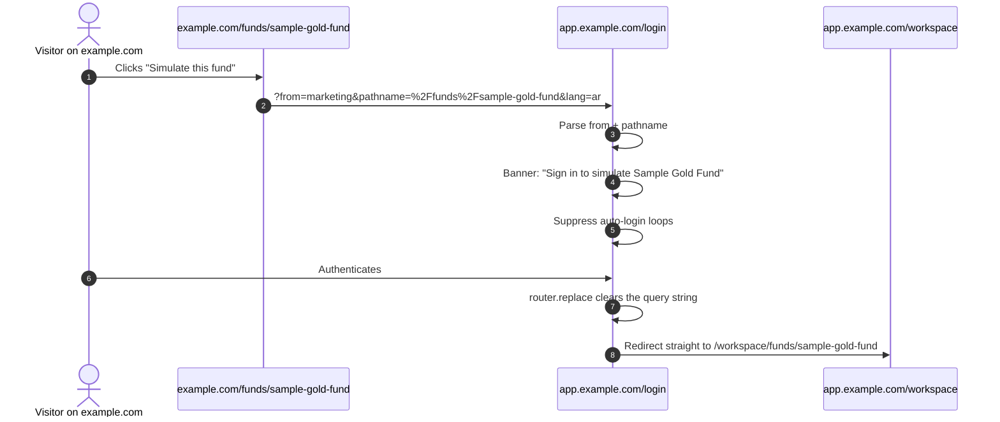

| Parameter combination | Login screen behaviour | Why it exists |
| :--- | :--- | :--- |
| `?from=logout` | "Signed out successfully" | **Disables auto-login hooks** such as Google One Tap. Without this, sign-out followed by an auto-login trigger loops the user back in and looks like a broken logout |
| `?reason=expired` | "Session expired — sign in again to continue" | Explains a redirect the user did not ask for, which otherwise reads as data loss |
| `?reason=reset` | "Password changed — sign in with your new password" | Confirms a security action completed |
| `?from=marketing&pathname=…` | "Sign in to simulate Sample Gold Fund" | Preserves intent; holds the destination until auth succeeds |
| `?from=invite` | Accept-the-invite framing | Provenance changes the promise the screen should make |

### Clean the Address Bar Immediately

A banner driven by a URL parameter that is never removed will reappear on refresh, on back-navigation and on a bookmarked URL. Read the parameters into reactive state, then erase them without a reload.

```typescript
// Inside the login screen's setup
import { onMounted } from 'vue';
import { useRoute, useRouter } from 'vue-router';

const route = useRoute();
const router = useRouter();

onMounted(() => {
  const { from, reason, pathname, lang } = route.query;

  if (lang) setLanguagePreference(String(lang));

  if (from === 'logout') {
    authUIStore.setBanner('logout_success');
    authUIStore.disableAutoLogin();      // breaks the logout/One-Tap loop
  } else if (reason === 'expired') {
    authUIStore.setBanner('session_expired');
  } else if (from === 'marketing' && pathname) {
    authUIStore.setAttributionPath(decodeURIComponent(String(pathname)));
  }

  // Silently strip the query so a refresh shows a clean screen.
  router.replace({ path: route.path, query: {} });
});
```

Attribution falls out of this for free. `from=marketing` recorded at the gateway is a conversion source that needs no cross-origin storage sharing, no tracker, and no identity stitching — the parameter is the attribution.

## Intent Preservation: Deep Linking Past the Auth Boundary

The highest-value moment in a funnel is the click that hits a login wall. Lose the user's action there and you do not get it back.

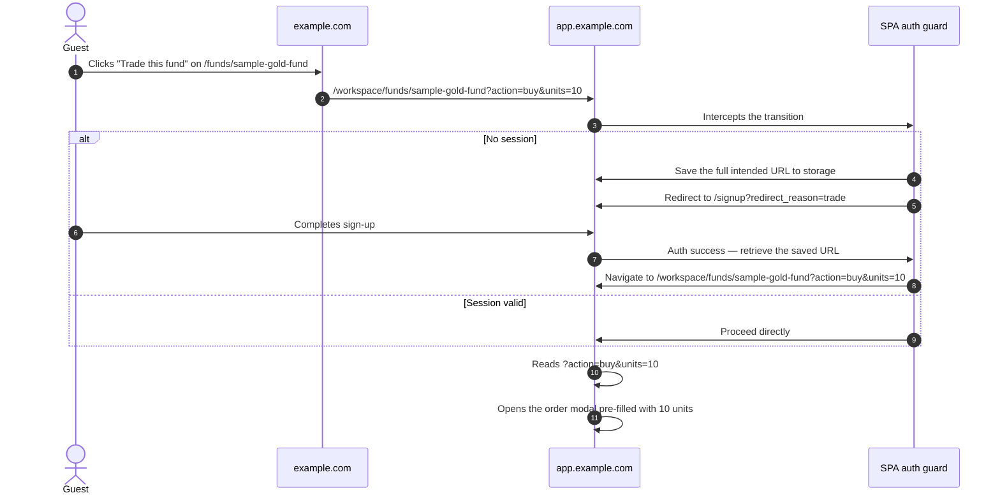

The guest lands inside a modal, quantity already filled, having signed up once. Nothing was re-typed and nothing was lost. Three mechanisms carry intent, and they are complementary rather than redundant:

| Mechanism | Where it is read | What it carries |
| :--- | :--- | :--- |
| `?from=…&pathname=…` | Auth gateway | Source of the visit plus the desired post-login path |
| `?action=buy&units=10` | A workspace route | The specific action and its arguments |
| Saved intended URL | Auth guard, before redirect | The complete URL, including path and both parameters |

### Validate `pathname` or You Have Built an Open Redirect

The line `setAttributionPath(decodeURIComponent(pathname))` followed by a post-login redirect to that value is an open redirect unless you constrain it. Accept only an **internal relative path**: starts with `/`, does not start with `//` (which is protocol-relative and escapes to another host), contains no scheme or authority, and ideally matches an allowlist of known destinations. Test it as a hostile input, not as a missing input.

This is the same class of bug as [guards in programming](/amr-tech/blogs/what-are-guards-in-programming-blog-package/) — the check that rejects a well-formed but malicious value, sitting apart from the check that rejects a malformed one. An auth guard that only handles signed-in versus signed-out has not guarded the interesting case.

## Pattern: The Public Showcase and Its Private Counterpart

The reusable architectural fact: **an entity that has a private editing surface and a public discovery surface needs two implementations of that entity, on two hosts, with two different data scopes.** Collapsing them into one route is the single most damaging shortcut available, because it puts private data behind a public URL and public traffic into a private code path.

The generic form, before any product detail:

| Dimension | Private surface | Public surface |
| :--- | :--- | :--- |
| Host | `app.example.com` | `example.com` |
| Rendering | Client-side, in the authenticated shell | Server-rendered HTML |
| Audience | The owner, authenticated | Guests, social bots, search crawlers |
| Indexing | Not indexed | Indexed and followed |
| Data | Complete record, all fields | Read-only whitelist projection |
| Capabilities | Edit, manage, export, transact | Read, share, sign-up CTA |
| Arrived from | App navigation | A shared link, a QR code, a search result |

### Worked Example: Investor Profile

The platform holds two fundamentally different representations of one user.

`app.example.com/profile` is the owner's control panel: total net asset value, cash balances, pending orders, executed transaction history, profit and loss. It holds legal name, date of birth, phone number, email, and guardian linkage for junior accounts. It manages gamification state — level, XP, unlocked medals, avatar. And it exports: it generates the public share card, the QR code, and the canonical public link.

`example.com/u/[username]` is a showcase. It is entirely read-only, **including for the owner viewing their own link**. It exists to be shared on WhatsApp, scanned at an event, and found on Google.

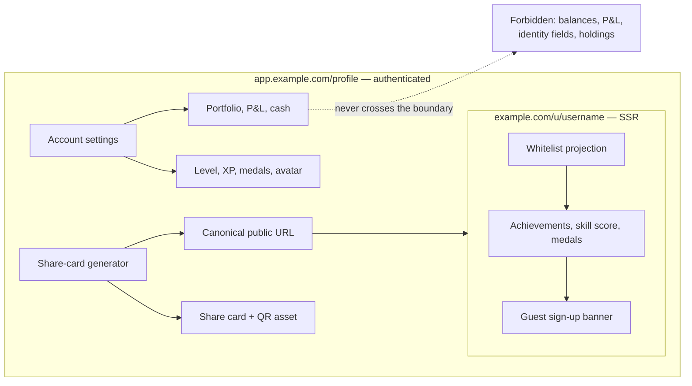

**Allowed in the public projection.** The username (up to 50 characters, non-Latin scripts supported, immutable after registration), an avatar identifier, the tier label (`junior` / `intermediate` / `expert`), level, cumulative XP, the array of unlocked medals with timestamps, and a derived skill score bounded `0 ≤ score ≤ 100`.

**Never allowed.** Absolute portfolio value in any currency. Absolute or percentage profit and loss. The holdings breakdown. Cash balance. Legal name. Email, phone, date of birth. Guardian account linkage. League rank and private group membership.

The name distinction carries weight: the legal name and the public username are separate fields with separate lifetimes, and the public projection is built from username only. Anyone who has seen a "display name" quietly used as both a login identity and a share-page title knows how that ends.

A blacklist is not a filter you apply to a full object. It is the reason the object is never loaded. The public route reads a projection that does not contain those columns, so a template mistake cannot leak what the API never returned — which is the difference between a policy and a control. This is why the two hosts share exactly one backend boundary, described in the security section.

## Pattern: Public Discovery vs. Private Execution

The second instance of the same shape: a catalogue that anyone may browse, and a workstation where authenticated users act.

| Dimension | Public hub `example.com/funds` | Workspace `app.example.com/workspace/funds` |
| :--- | :--- | :--- |
| Rendering | SSR | Client-rendered SPA |
| Audience | Crawlers, guests | Authenticated users |
| Indexing | `index, follow` | Not indexed |
| Data source | Cached catalogue synced from the external directory | Same cache, plus the active user's portfolio state |
| Search and filtering | Server-rendered category links; static index | Multi-select chips, instant client-side search, sorting |
| Acting on an item | A bridging CTA carrying deep-link state | Order modal with balance validation |
| Feedback | None — read-only | Audio cues, toasts, immediate portfolio reconciliation |

### Canonical Slugs, the 301 Engine, and Covering Every Entity

Three rules on the public side, in order of how often they get skipped.

**Canonical slug form.** `/funds/:slug` where the slug matches `^[a-z0-9-]{3,100}$`. Human-readable, stable, and indexable.

**Legacy identifiers resolve, they do not duplicate.** A request arriving with a 15-character database record ID gets a `301` to the canonical slug. Serving the same fund at two URLs splits its ranking signals and creates a canonical-conflict you will debug for a week. One URL per entity, everything else redirects.

**Invalid entities answer `404` with `noindex, nofollow`.** A soft 404 — a page that renders an empty shell with status `200` — is the worst outcome, because the crawler dutifully indexes the emptiness.

Then the rule that makes a directory indexable at all. The hub page emits real `<a href="/funds/:slug">` HTML links for **100% of active entities** in the catalogue cache. A grid of highlighted cards plus a client-side "load more" that fetches from the API is a directory whose long tail does not exist: a crawler that never runs JavaScript sees twenty items in a catalogue of twenty thousand. Feature the popular entries visually if you like, but render a lightweight, complete link index for the remainder in the same packet.

Partial coverage is not a small omission. For a directory whose value *is* its coverage, an index that reaches 2% of the catalogue is an index of a different, smaller product.

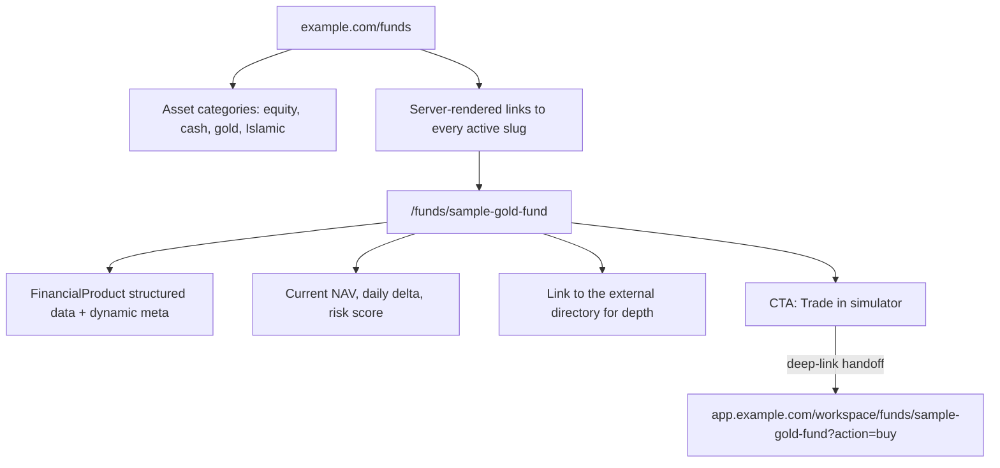

### The Private Side Is a State Machine, Not a Page

Once authenticated, the interaction has real states and transitions worth drawing — the discipline is the same one behind [state and condition separation](/amr-tech/blogs/pvc/extensions/state-vs-condition/).

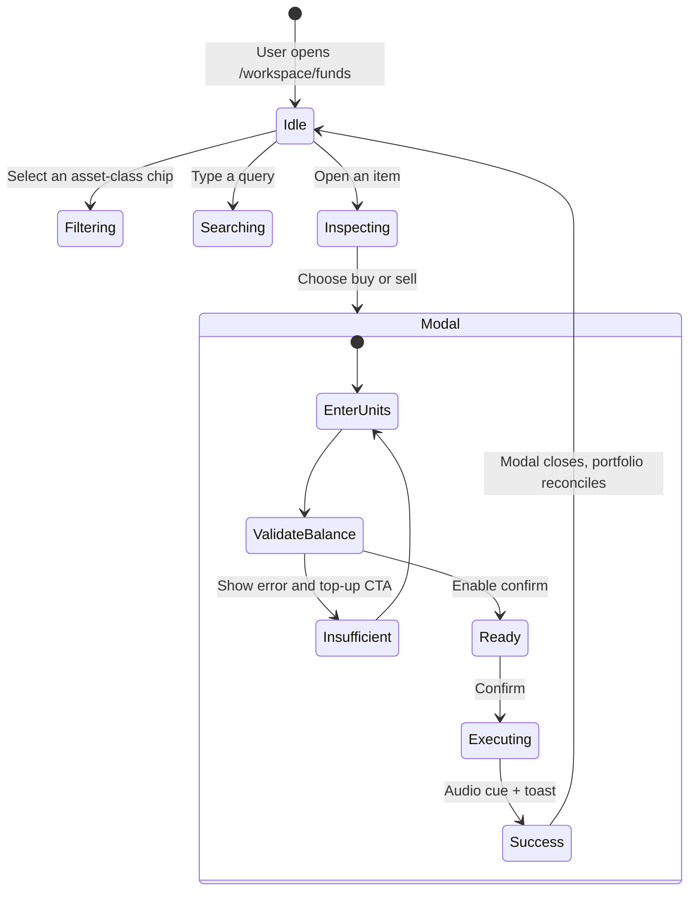

No transition reloads the document. That is the trade the SPA half of the split exists to make, and it is exactly what you do *not* want on a public page.

## First-Packet SEO: What Must Be in the Very First Response

The doctrine has one sentence: **everything a crawler needs arrives in the first HTML document, with no JavaScript required to produce it.** Astro, Nuxt, Next.js in prerender mode, a SvelteKit adapter — the framework is a detail. The requirement is about what is in the bytes.

Google's [JavaScript SEO documentation](https://developers.google.com/search/docs/appearance/javascript-linking) is explicit that Googlebot renders pages in a queue with a delay and that content requiring rendering is not guaranteed to be discovered or indexed; [documentation on crawling efficiency](https://developers.google.com/search/docs/crawling-indexing/learn-more-crawling) makes the budget argument. The safe engineering position is to treat rendering as unavailable. Your public pages must be complete before any script runs, because *some* of the crawlers that matter — social platforms, search engines under load, every AI assistant fetcher — do not run it at all.

The rule I would defend: **substantive prose in the first packet.** The original spec fixed a number at 500 words per public page. Treat that as a starting bar rather than a law — the honest requirement is that a page's real content, in enough depth to answer the query it targets, is present without rendering. Thin pages that hit an arbitrary count are still thin.

### The Public Profile Pipeline

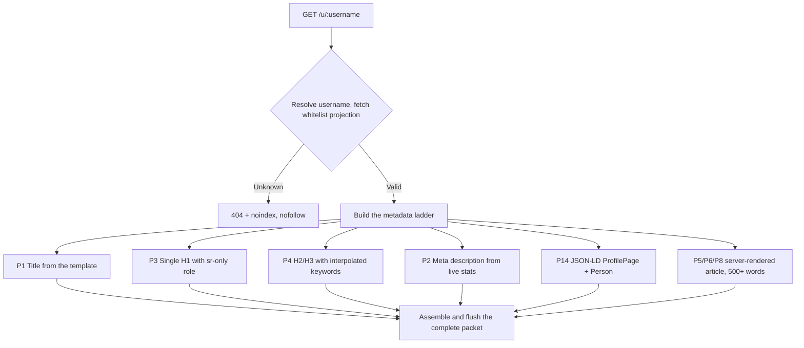

Every branch is server-side. The `404` branch is the one people forget, and it is the one that decides whether your index fills with placeholder pages.

### The Metadata Ladder, Both Languages

Titles and descriptions are generated from templates with real values interpolated. Two constraints fight each other: the template must be consistent enough to be trustworthy and specific enough that no two pages read alike.

**Title (target 30–60 characters).**

| | |
| :--- | :--- |
| Template | `{username} — {profileDescriptor} \| {brandName}` |
| Arabic | `مستخدم — ملف المستثمر وإنجازاته \| مثال` |
| English | `demo_user — Investor Profile & Achievements \| Example` |
| Overflow | Trim a long username at a word boundary, keeping the readable core — never mid-token |
| Underflow | Pad a very short username with the tier qualifier so the title still carries meaning |

**One `<h1>` (target ≤ 40 characters).** The visible text is the username; the semantic role travels in a visually-hidden span, so assistive technology and crawlers get "investor" while the design gets a clean heading.

```html
<h1>demo_user <span class="sr-only">— Example Investor</span></h1>
<h1>مستخدم <span class="sr-only">— مستثمر مثال</span></h1>
```

**Subheadings.** `<h2>` for achievements and medals, `<h3>` for skill score and progression, both with the name interpolated.

**Description (target ≤ 160 characters).** Built from the values that actually change: level, tier, skill score, XP, medal count.

```
{username} on Example: investor at {levelTitle} ({tierLabel})
with Skill Score {skillScore}/100, {xpTotal} XP, and {medalCount} medals.
```

**Structured data.** A `ProfilePage` whose `mainEntity` is a `Person`.

```json
{
  "@context": "https://schema.org",
  "@type": "ProfilePage",
  "mainEntity": {
    "@type": "Person",
    "name": "demo_user",
    "identifier": "demo_user",
    "image": "https://example.com/assets/avatars/avatar_12.svg",
    "description": "Investor on the Example simulation platform."
  },
  "url": "https://example.com/u/demo_user"
}
```

### The Uniqueness Test: Mask the Name

The trap in generated-per-entity pages is that they are not generated at all — one paragraph of boilerplate with the name slotted in, multiplied by every user. Search engines can recognise that, and users certainly can.

The test worth adopting: **blank out the entity's name and read the page. If it still says something specific and true about that entity, it is unique. If it reads like the site's own description, it is duplicate content with a variable in it.**

To pass it, the prose branches on state that differs per entity — the tier, level progress and milestone position, a band derived from the score (`≤ 40` developing, `41–70` proficient, `71–100` master), and which medals are unlocked versus still locked, iterated over the catalogue with timestamps. Three or four independent branches produces genuinely divergent text; one branch produces a template with a swappable noun.

Note what this is *not*: it is not an instruction to pad. Depth that earns its place is fine; 500 words of restated boilerplate is worse than 150 words of fact, and it is detectably worse.

### Entity Detail Pages

Same ladder, different schema.

```
{fundName} — {localizedMetric} | {brandName}
Sample Gold Fund — NAV Price & Performance | Example
صندوق الذهب النموذجي — سعر الوثيقة والأداء | مثال
```

```json
{
  "@context": "https://schema.org",
  "@type": "FinancialProduct",
  "name": "Sample Gold Fund",
  "description": "Sample Gold investment fund NAV tracking and simulation.",
  "category": "Gold / Commodity",
  "url": "https://example.com/funds/sample-gold-fund",
  "offers": {
    "@type": "Offer",
    "price": "14.25",
    "priceCurrency": "USD"
  }
}
```

The body carries the current unit price, the daily change, a risk score, an outbound link to the authoritative external directory, and the bridging CTA. `FinancialProduct` is the correct type for a financial instrument (see [schema.org's FinancialProduct](https://schema.org/FinancialProduct)); a generic `Article` would describe the page rather than the thing, which is the wrong entity for a page whose subject is a product.

## SEO for the Application's Gateway Pages

`app.example.com` is a private SPA and its routes are not indexable content. Two pages are the exception, deliberately: `/login` and `/signup`. People search for your product by name plus "login", and a page that exists to answer that query should be there.

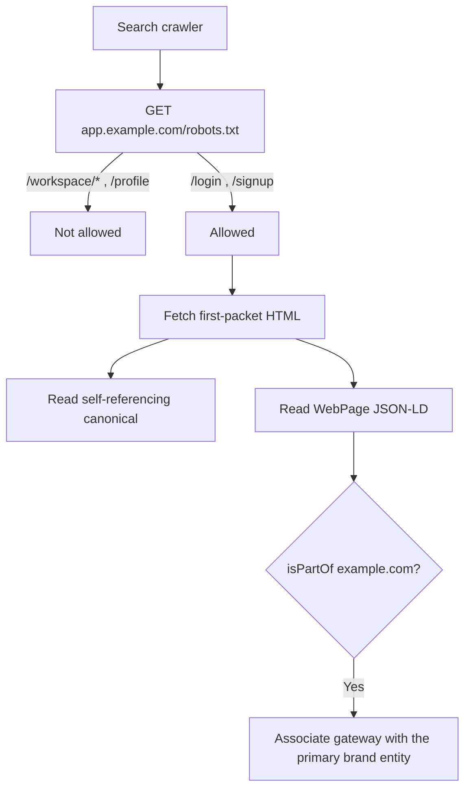

### `robots.txt`

```text
User-agent: *
Allow: /login
Allow: /signup
Disallow: /
```

Now the trap. The original specification also wanted those private routes *noindexed*, and drew them as both disallowed and noindexed. Those do not compose the way people expect. **If `robots.txt` blocks the URL, the crawler never fetches the page, so it never sees the `noindex` directive** — and a URL blocked in `robots.txt` can still appear in the index from other signals such as inbound links, without a snippet. Google states this plainly in its documentation on [noindexing](https://developers.google.com/search/docs/crawling-indexing/block-indexing) and [robots.txt](https://developers.google.com/search/docs/crawling-indexing/robots/intro).

Choose one, and choose it per route:

- Want it genuinely out of the index while links remain harmless? **Allow crawling, return `X-Robots-Tag: noindex`** (or a `noindex` meta) so the crawler can see the instruction.
- Want to save crawl budget and never risk a snippet? **Block in `robots.txt`**, and accept that the URL may still be listed.
- Want both? You cannot, in one pass. Blocking and noindexing are different jobs.

For a private workspace, an authenticated `401`/redirect-to-login for a guest is usually a better answer than either, because the page does not exist for a crawler at all.

### Canonicals on a Gateway

The gateway pages must declare **self-referencing** canonicals — `https://app.example.com/login` — not point at `example.com`. Pointing at the marketing host while serving different content is a canonical mismatch, which is the classic way to make a crawler distrust both pages.

```html
<title>تسجيل الدخول — مثال | Login</title>
<meta name="description" content="سجّل دخولك إلى محاكي الاستثمار لمتابعة محفظتك وتداول صناديق الاستثمار." />
<meta name="robots" content="index, follow" />
<link rel="canonical" href="https://app.example.com/login" />
```

```html
<title>إنشاء حساب جديد — مثال | Sign up</title>
<meta name="description" content="أنشئ حساباً جديداً مجاناً وابدأ التداول في محاكي الاستثمار وجرّب استراتيجياتك المالية." />
<meta name="robots" content="index, follow" />
<link rel="canonical" href="https://app.example.com/signup" />
```

Both need the same treatment. A reference example usually gets written for `/login` and `/signup` is assumed to follow, and six months later one of the two highest-intent pages in your funnel is missing its structured data.

### Declaring the Relationship with `isPartOf`

The gateway is a different host from the brand's canonical home. Say so in the structured data, so the entity graph connects rather than forks.

```html
<script type="application/ld+json">
{
  "@context": "https://schema.org",
  "@type": "WebPage",
  "name": "تسجيل الدخول — مثال",
  "url": "https://app.example.com/login",
  "isPartOf": {
    "@type": "WebSite",
    "name": "مثال",
    "url": "https://example.com"
  }
}
</script>
```

This is the whole answer to "does splitting across subdomains split my SEO?" The authority accrues on the root and the declaration links the gateway to the primary entity. `isPartOf` is defined on [schema.org's CreativeWork](https://schema.org/isPartOf).

## Open Graph: Crawlers That Never Run JavaScript

The single most consequential fact about social sharing is that link-preview crawlers fetch a URL and read the HTML. They do not execute the bundle and wait. WhatsApp, Telegram, Facebook, X and LinkedIn all behave this way; it is the premise of the [Open Graph protocol](https://ogp.me/), whose tags exist precisely so a fetcher can read metadata without understanding the page. Whatever your SPA renders after boot is invisible to them.

That produces two share paths, and only one of them works by accident.

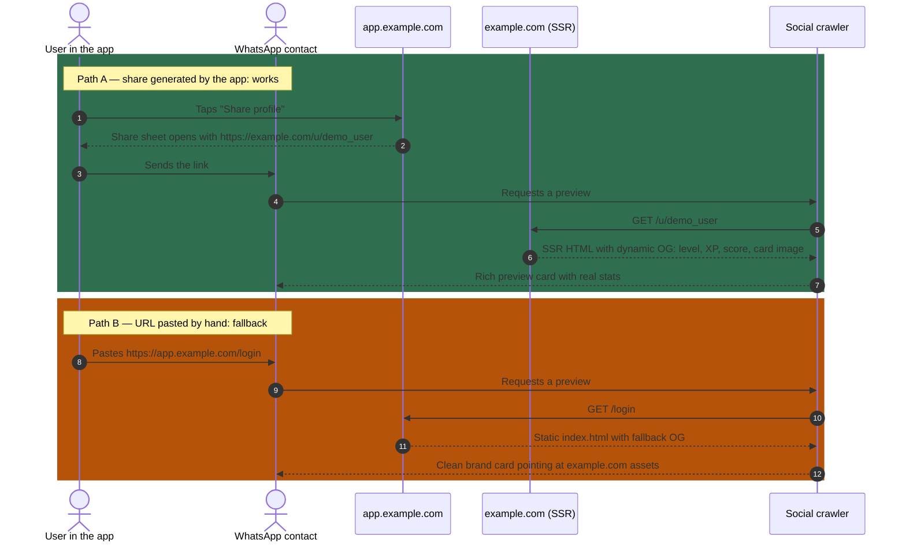

**Path A is the rule.** Every share action originating inside the app must mint a **public-domain URL**, never an `app.example.com` one. "Share profile" generates `https://example.com/u/[username]`; "share this fund" generates `https://example.com/funds/[slug]`. The app's own URLs have no server-rendered content for the crawler to read, so sharing them yields a blank or wrong preview. Route all sharing through the SSR host and the dynamic card comes free.

```html
<!-- Server-rendered for https://example.com/u/%D9%85%D8%B3%D8%AA%D8%AE%D8%AF%D9%85 -->
<meta property="og:type" content="profile" />
<meta property="og:site_name" content="مثال" />
<meta property="og:title" content="مستخدم — ملف المستثمر وإنجازاته | مثال" />
<meta property="og:description" content="مستثمر في مستوى 12 بدرجة مهارة 85/100 و3,450 نقطة خبرة." />
<meta property="og:url" content="https://example.com/u/%D9%85%D8%B3%D8%AA%D8%AE%D8%AF%D9%85" />
<meta property="og:image" content="https://example.com/api/og/u/%D9%85%D8%B3%D8%AA%D8%AE%D8%AF%D9%85.png" />
<meta property="og:image:width" content="1200" />
<meta property="og:image:height" content="630" />
<meta property="og:image:type" content="image/png" />
```

**Path B is the insurance.** Someone will paste `https://app.example.com/login` into a chat. Put static fallback tags in the app shell's `index.html` that describe the brand and point at the canonical host's assets.

```html
<!-- Static fallback in app.example.com/index.html -->
<meta property="og:type" content="website" />
<meta property="og:site_name" content="مثال" />
<meta property="og:title" content="مثال — محاكي الاستثمار والتداول" />
<meta property="og:description" content="تعلّم الاستثمار وجرّب التداول في صناديق الاستثمار المصرية بدون مخاطرة." />
<meta property="og:url" content="https://example.com" />
<meta property="og:image" content="https://example.com/assets/images/og-default-brand.png" />
<meta property="og:image:width" content="1200" />
<meta property="og:image:height" content="630" />
```

### Three Rules That Break Shares Silently

**Encode every non-Latin identifier.** Arabic usernames and slugs go through `encodeURIComponent` before they touch `og:url`, `og:image`, the canonical or the sitemap. Unencoded, the same profile exists at two spellings; the crawler follows one and the index prefers the other, and your canonical tag quietly disagrees with the URL being shared. `/u/مستخدم` must ship as `/u/%D9%85%D8%B3%D8%AA%D8%AE%D8%AF%D9%85` everywhere at once, not in whichever places someone remembered.

**Serve PNG or JPEG. Not SVG.** `og:image` points at a resource fetched by a parser, not rendered by a browser, and SVG is unsupported by the major consumers — Meta's sharing documentation lists supported image types for link previews ([developer docs on link preview best practices](https://developers.facebook.com/docs/sharing/best-practices)), and both X and LinkedIn document raster-only support. The de-facto standard geometry is **1200×630** at the 1.91:1 aspect ratio that Meta recommends; declare `og:image:width` and `og:image:height` so the parser does not have to decide whether to wait for the image to load before rendering the card.

**Cache dynamic OG images, deliberately.** A `/api/og/...` endpoint renders an image per entity per request; during a viral spike that is a per-message rendering storm on your own origin.

```http
Cache-Control: public, max-age=900, s-maxage=3600, stale-while-revalidate=86400
```

Read the values as positions: serve a stale shared image rather than block on regeneration (`stale-while-revalidate`), keep it long in the CDN (`s-maxage`) because crawlers re-fetch the same URL repeatedly, keep it briefly in the browser (`max-age`) because stats change. Note that the public API cache policy from the security section uses `s-maxage=3600, stale-while-revalidate=59` — same shape, different revalidation window, because the two resources have different tolerances for staleness. Document why, or the next engineer "fixes" the inconsistency.

## Security and the API Boundary

Two surfaces, one backend, and a boundary that is enforced in code rather than in a template.

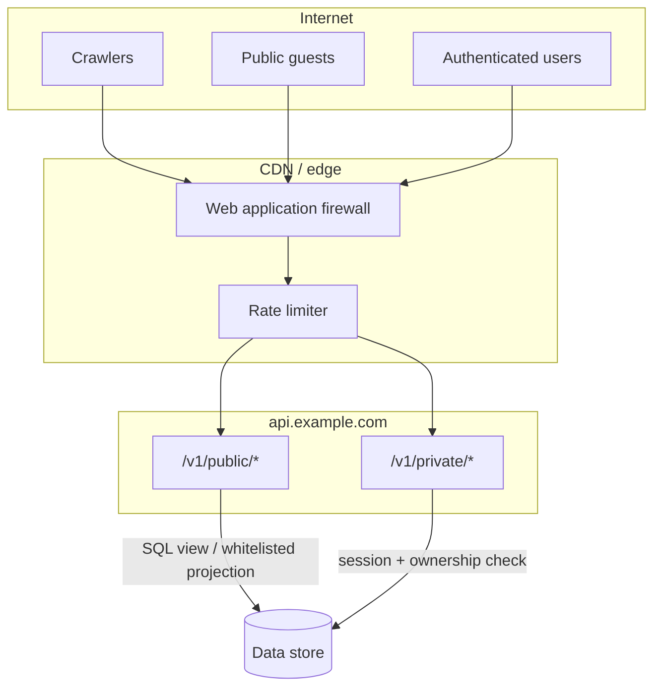

| | `/v1/public/*` | `/v1/private/*` |
| :--- | :--- | :--- |
| **Authentication** | None | Session cookie or bearer token, strictly required |
| **Caching** | `public, s-maxage=3600, stale-while-revalidate=59` | `no-store, private` |
| **Data returned** | Whitelist projection only; a request naming a private field is a `400` | The caller's own portfolio, balances, tickets |
| **CORS origin** | `https://example.com` | `https://app.example.com` plus authorised native schemes |
| **Database path** | A view or projection that excludes private columns | Full record, after authentication and an ownership check |

The row that does the work is the last one of the data pair. A public endpoint that accepts a field list and returns whatever it is asked for has no boundary — it has a convention. Returning `400` for a request that names `cash_balance` is good, and it is still one bug away from a leak if the underlying query selects everything. The **SQL view** is the control: the private columns are not in the object the handler can reach. Same principle as the profile projection above — don't filter secrets, don't load them.

Everything else in the design supports this: third-party trackers are confined to `example.com`, so a compromise there cannot read `app.example.com` data; the `__Host-session` cookie cannot be planted by a sibling subdomain; native tokens live in the Keychain or Keystore rather than in web storage; and a WAF plus a rate limiter sit in front of both families, because the public one is your highest-volume unauthenticated surface.

### CORS and the Dual-Cookie Response

```typescript
// server.ts — api.example.com
import express from 'express';
import cors from 'cors';
import cookieParser from 'cookie-parser';

const app = express();
app.use(cookieParser());

const ALLOWED_ORIGINS = [
  'https://example.com',
  'https://www.example.com',
  'https://app.example.com',
  'http://localhost:8100',    // Ionic dev webview
  'capacitor://localhost',    // iOS scheme
  'http://localhost',          // Android scheme
];

app.use(cors({
  origin(origin, callback) {
    // Native requests often send no Origin at all.
    if (!origin || ALLOWED_ORIGINS.includes(origin)) return callback(null, true);
    callback(new Error(`CORS blocked for origin: ${origin}`));
  },
  credentials: true,
}));

app.post('/v1/auth/login', (req, res) => {
  const { email, password } = req.body;
  const platform = req.headers['x-client-platform'];
  const userId = 'usr_example123'; // placeholder

  if (platform === 'ionic-native') {
    return res.json({ user: { id: userId, email }, access_token: 'eyJhbGciOi…' });
  }

  // Host-locked session: note the absence of `domain`.
  res.cookie('__Host-session', `s_${userId}`, {
    httpOnly: true, secure: true, sameSite: 'lax', path: '/',
  });

  // Harmless hint, readable by the edge and by scripts.
  res.cookie('app_logged_in', '1', {
    httpOnly: false, secure: true, sameSite: 'lax',
    domain: '.example.com', path: '/', maxAge: 30 * 24 * 3600 * 1000,
  });

  res.json({ user: { id: userId, email } });
});
```

Two things to read carefully. `credentials: true` pairs with `credentials: 'include'` on the client — one without the other silently does nothing, and the symptom is a user who logs in successfully and is immediately logged out. And the `__Host-session` call sets **no** `domain` option; adding one is a refactor someone will attempt when they want the marketing host to read the session. That is the exact thing the prefix exists to prevent, so leave a comment on the line saying so.

### The Edge Middleware That Reads the Hint

```typescript
// middleware.ts — running on example.com's edge router
import { NextResponse } from 'next/server';
import type { NextRequest } from 'next/server';

export function middleware(request: NextRequest) {
  const { pathname } = request.nextUrl;

  // Harmless, shared across .example.com. Carries no credential.
  const isLoggedIn = request.cookies.get('app_logged_in')?.value === '1';

  if (isLoggedIn && (pathname === '/' || pathname === '/login' || pathname === '/signup')) {
    const appUrl = new URL('https://app.example.com/workspace/dashboard');
    appUrl.searchParams.set('from', 'marketing_auto_redirect');
    return NextResponse.redirect(appUrl, 302);
  }

  return NextResponse.next();
}

export const config = { matcher: ['/', '/login', '/signup'] };
```

The matcher is the part to argue about. Restricting it to `/`, `/login` and `/signup` means a signed-in user browsing a public fund page still gets the marketing page — which is correct, since that page is why they are there. Redirect all logged-in traffic from the entire marketing host and you have destroyed the public funnel for your existing users, which is the population most likely to share it.

The `302` here sits alongside the `301` bridging table on the *same paths*, which is a real precedence question: `/login` on `example.com` has a permanent bridging rule to `app.example.com/login` and a conditional temporary redirect to the dashboard. Decide the order explicitly — bridge first, or session first — and write it down, because edge rules and application middleware are usually authored by different people and neither will notice the conflict until a user reports being bounced.

## A Design System That Survives Two Domains

Split the codebase and the brand splits too, unless you plan the styling as two layers with different mutability.

The architecture: **Sass modularity for compile-time composition, native CSS custom properties for runtime theming**, with one file at the intersection that nobody else is allowed to edit.

| Path | Role | Mutability |
| :--- | :--- | :--- |
| `packages/shared/styles/_brand.scss` | Single source of brand truth | Edited rarely, by one owner, reviewed |
| `apps/marketing/src/styles/theme.scss` | Display fonts, pill buttons, wide spacing | Marketing team, freely |
| `apps/app/src/styles/theme.scss` | System fonts, Ionic bindings, isolated dark mode | App team, freely |

`_brand.scss` publishes identity as runtime variables on `:root`.

```scss
// packages/shared/styles/_brand.scss
:root {
  --brand-primary: #2383e2;
  --brand-primary-hover: #105fad;
  --brand-primary-accent: #00c2a8;

  /* Financial semantics: the two colours users read as safety */
  --brand-profit: #16a34a;
  --brand-loss: #dc2626;

  --brand-gray-50: #fcfcfb;
  --brand-gray-100: #f9f9f8;
  --brand-gray-500: #78736f;
  --brand-gray-900: #191918;
}
```

Each surface then `@use`s it and diverges on everything that is *not* identity.

```scss
// apps/marketing/src/styles/theme.scss
@use '@example/shared/styles/brand';

:root {
  --font-display: 'Brand Display', sans-serif;
  --font-body: 'Brand Body', sans-serif;
  --radius-btn: 9999px;      /* pill: inviting, high-contrast affordance */
  --radius-card: 1.25rem;
  --section-gap: 5rem;
}

body { font-family: var(--font-body); background: var(--brand-gray-50); color: var(--brand-gray-900); }
h1, h2, h3 { font-family: var(--font-display); }
```

```scss
// apps/app/src/styles/theme.scss
@use '@example/shared/styles/brand';

:root {
  --font-ui: system-ui, -apple-system, 'Segoe UI', sans-serif;
  --radius-btn: 8px;         /* dense, operational */
  --radius-card: 10px;

  /* Brand mapped onto Ionic's own token surface */
  --ion-color-primary: var(--brand-primary);
  --ion-color-success: var(--brand-profit);
  --ion-color-danger:  var(--brand-loss);
  --ion-font-family: var(--font-ui);

  --app-bg: #ffffff;
  --app-surface: var(--brand-gray-100);
  --app-text: var(--brand-gray-900);
}

/* Dark mode is scoped to the app, not to the brand */
body.dark {
  --app-bg: #191919;
  --app-surface: #202020;
  --app-text: #f0efed;
  --ion-color-primary: #3b95f3;   /* lifted: #2383e2 is too dark on near-black */
  --ion-background-color: var(--app-bg);
  --ion-text-color: var(--app-text);
}
```

| Aspect | Marketing | Application |
| :--- | :--- | :--- |
| Typography | Custom display + body fonts | `system-ui` stack |
| Button radius | `9999px` pill | `8px` |
| Card radius | `1.25rem` | `10px` |
| Section spacing | `5rem` | none — density is the design |
| Component bindings | none | `--ion-color-*`, `--ion-font-family` |
| Dark mode | not offered | isolated under `body.dark` |
| Primary in dark | n/a | lifted to `#3b95f3` |

The principle to hold onto: **identity tokens are shared and stable; expression tokens are per-surface and free to differ.** Colour that signals money is not an expression. Typography that sets a mood is. Two independent release trains can then change the marketing look entirely without touching a single colour a user relies on inside the app.

## Case Study: Reading Notion's Split

Notion is the clearest public example of this architecture taken seriously, and it is checkable in a browser console in ten minutes. What follows is from runtime DOM inspection of `www.notion.com` and `app.notion.com`; counts and token names drift between deploys, so re-measure rather than trusting the numbers — the *shape* is the finding, not the figures.

### Fonts: One Host Downloads, One Host Does Not

`www.notion.com` loads custom branded web fonts. `app.notion.com` loads none: filtering `document.fonts` for loaded faces on the app returns an empty list, because the computed stack is native throughout.

```css
/* computed on app.notion.com */
font-family: ui-sans-serif, -apple-system, BlinkMacSystemFont,
  "Segoe UI Variable Display", "Segoe UI", Helvetica, "Apple Color Emoji",
  "Noto Sans Arabic", "Noto Sans Hebrew", Arial, sans-serif;
```

Two reasons, both about money rather than taste. There is no FOIT or FOUT in the workstation: text paints once, at the right metrics, so layout shift is structurally impossible rather than merely reduced. And startup makes zero font requests: no `.woff2` fetch before the first interaction, which on a mid-range Android device in a slow network is the difference between a usable app and a blank wait.

The Arabic and Hebrew entries in that stack are the detail worth noticing. A system stack is only "free" if it covers your actual scripts; where it does not, you are back to downloading fonts on the host that promised not to.

### Two Token Namespaces That Share No Names

The marketing host exposes a large variable surface under one prefix — in the inspected build, roughly 1,300 custom properties named after an internal marketing design system, organised as scale and semantic role (`--tatami-border-radius-400`, `--tatami-color-gray-900`). The app exposes a different set under different prefixes organised by mode (`--c-palUiBlu600`, `--cd-palPin600`, `--cl-palPin30`, `--ca-*` for alpha values).

They do not overlap. There is no shared token file, no import, no build step copying one into the other. Two teams shipped two design systems inside one company, and users cannot tell.

### Color Space Follows Purpose

Marketing uses perceptually uniform color, `oklch()`, in the modern CSS color syntax: gradients and ramp generation with even lightness steps, which is what a decorative surface needs. The app uses eight-digit hex with embedded alpha (`#2383e224` — the trailing `24` being the alpha byte): fast to parse, and conservative about older webviews and embedded mobile runtimes that a marketing site can afford to drop and a packaged app cannot.

Same brand, two color models, chosen for the rendering environment each surface actually has to survive.

### Geometry Is Density

Marketing publishes a radius scale running to full pills for a large-target, inviting affordance. The app exposes no global radius variable at all — values sit in components, in the 4–6px range, because a dense data UI cannot afford 12px corners on every control.

### The Cohesion Mechanism: Constant Hex Values

Across two unrelated token systems, `#2383e2` appears as the primary on both, and the dark neutral `#191918` likewise. Notion's brand continuity is maintained by **hand-matching literal colour values between two architectures that share nothing else.**

That is worth naming for what it is: it works, and it works because brand colour changes rarely and someone remembers. It is also a manual synchronisation between two repos with no compile-time check — the failure mode is a slow divergence that nobody notices until a design review catches it. The `_brand.scss` approach in the previous section exists to make the same guarantee a build constraint instead of a habit: one file, imported by both surfaces, so the match is enforced rather than remembered.

### What the Teardown Actually Teaches

| | Notion's split | The single-source alternative |
| :--- | :--- | :--- |
| Shared colour truth | Identical hex, matched by convention | One `@use`d file, matched by the compiler |
| App typography | System stack | System stack |
| Marketing typography | Branded web fonts | Branded web fonts |
| Radius strategy | Marketing scale, app hardcoded | Both variable-driven, different values |
| Token namespaces | Disjoint, two systems | Disjoint, but seeded from one source |

The conclusion is not "copy Notion". It is that **the split is real and the brand survives it because one property is treated as sacred.** Separate tokens, separate fonts, separate geometry — and one colour vocabulary that neither side is allowed to invent.

## The Asset Pipeline: Three Tiers

Asset placement is a packaging decision, not a filing convention. The constraint that decides it: every byte under the app's asset root is inside the installed bundle, and every byte served from the marketing origin must be reachable by a crawler reading a public page.

| Tier | Examples | Location | Delivery |
| :--- | :--- | :--- | :--- |
| **Shared, entity-referenced** | Avatars, fund and category icons, medal artwork | `packages/shared/assets/` | Build-synced into both public roots, or served from `assets.example.com` (R2) |
| **Marketing-only** | Hero illustrations, blog imagery, campaign art | `apps/marketing/src/assets/` | Marketing bundle only; excluded from the app and the native package |
| **App-only** | Trade and success audio cues, interaction animations | `apps/app/src/assets/` | Bundled inside the webview shell |

The tier that earns its complexity is the first. Entities in the database reference artwork by stable identifier — `/assets/avatars/{avatarId}.svg` — so the same URL must resolve from the marketing origin (for SSR pages and crawlers) *and* be present inside the native package (for offline). Two delivery mechanisms, one path contract, synchronised by a build step. Do not solve this by having the app fetch avatars from the marketing host at runtime: that adds a network dependency to a screen that must render offline, and it puts a CDN cache between you and every broken icon being reported as a data bug.

Audio cues belong to the app alone for a simpler reason — they are the product's feedback language, and shipping them to a landing page serves no one. The marketing tier belongs to the marketing site for the mirror-image reason: the installer size is the price of letting campaign art into the app bundle.

## The Audit: Decisions People Leave Contradictory

This is the part of the exercise that matters most and gets skipped most. The architecture above was assembled from separately authored specifications — routing, UX, authentication, SEO — and each contradiction below is a place where two of them disagreed about the same fact. Nobody caught them in review because each document was internally consistent.

This is not a hypothetical list. It is what an audit of one real blueprint produced, and it is what yours will produce too, because the failure mode is structural: the marketing team owns a routing table, the app team owns a router, the auth work owns a cookie, and the SEO pass owns a `robots.txt`, and no single artifact contains all four.

| # | Topic | Option A | Option B | What must happen |
| :-: | :--- | :--- | :--- | :--- |
| 1 | Auth route paths | `/login`, `/signup` | `/auth/login`, `/auth/signup` | Pick one. `robots.txt`, canonicals, OG tags and the bridging table must all agree with it |
| 2 | Post-login home | `/dashboard` | `/workspace/dashboard` | One destination, referenced identically by the edge middleware and the router |
| 3 | Session cookie | `app_token` with `Domain=.example.com` | `__Host-session` with no `Domain` | Adopt one. The `__Host-` form is strictly safer; the wildcard form is why the split was made |
| 4 | Login indicator | `app_session_active=true` | `app_logged_in=1` | One name and one value, shared between the writer and the edge reader |
| 5 | Platform signal | Header `X-Client-Type: ionic-native` | Header `X-Client-Platform` and query `platform=mobile_native` | One header. Three spellings of one fact means one of them is dead code |
| 6 | `clientBuildTarget` values | `client` / `desktop` / `mobile_native` | `web` / `mobile_native` / `desktop` | Decide whether web is `client` or `web` |
| 7 | Native token storage | `@capacitor/preferences` | `capacitor-secure-storage-plugin` | One library. See the warning: they are not equivalent |
| 8 | Web auth mechanism | `HttpOnly` cookie | Bearer in `Authorization`, "session token in storage" in the guard | State that bearer is mobile-only, and rewrite the guard description for web |
| 9 | Redirecting signed-in users | Edge `302` from marketing to app | Principle: "zero unexpected cross-domain redirects" | Not actually in conflict — the principle protects users inside the app, the redirect serves visits to marketing. Say so in the document |
| 10 | Marketing `/login` | Middleware: signed in → `302` to dashboard | Bridging: `301` to `app.example.com/login` | Same path, two different status codes. Declare precedence |

Row 9 is the instructive one: it looked like a contradiction and was not, it was an unstated scope. Half of "conflicting specifications" resolve the moment someone writes down *which population* a rule applies to.

### Six Technical Notes That Are Not Style Preferences

**`@capacitor/preferences` is not encrypted.** It maps to `SharedPreferences` on Android and `UserDefaults` on iOS. Calling it a "secure native keychain" in a spec is a documentation bug with security consequences. Verify against the library you shipped, today.

**`pathname` needs an allowlist, not a decoder.** `decodeURIComponent` followed by a redirect is an open redirect unless the value is constrained to an internal relative path — starts with `/`, never `//`, no scheme, no authority.

**`Disallow` and `noindex` are not additive.** Blocking a path in `robots.txt` prevents the crawler from ever seeing the `noindex` on it. Pick the mechanism that matches the goal.

**The gateway's `og:url` and its canonical disagree on purpose.** `og:url` points to `https://example.com` because the *brand* card is the fallback; the canonical points to `https://app.example.com/login` because that is the *page*. Correct, and permanently mistaken for a bug by anyone who reads it without this sentence. Write the reason in a comment.

**Structured data must exist for both gateway pages.** Reference examples get written for one of two sibling routes and the other ships without it.

**Arabic usernames need `encodeURIComponent` in every position at once** — OG, canonical, sitemap, hreflang if you have it. Encoding in two of four places creates four canonical spellings of one profile.

### What the Blueprint Did Not Cover

Gaps are part of an honest specification, so here are the ones this architecture left open:

- No `sitemap.xml` strategy, despite a rule requiring a link to every active entity and a Search Console property to submit it to.
- No `hreflang` or version management for the two languages, even though every template exists in both.
- No refresh-token rotation for the **web** cookie session — the flow was specified for native PKCE only.
- No `/reset-password` page design beyond a route and a `reason=reset` value.
- `/pricing`, `/privacy` and `/terms` appear in the bridging table but not in the route map, so their renderer and indexing decision are undeclared.

## Launch Checklists

### Before the Marketing Host Ships

- [ ] Every public route delivers complete prose in the first packet, with no JavaScript dependency.
- [ ] Title 30–60 characters, description ≤ 160, exactly one `<h1>` ≤ 40.
- [ ] Correct structured data per type: `ProfilePage`/`Person` for profiles, the product type for catalogue items.
- [ ] The directory index links to **100%** of active entities as HTML anchors.
- [ ] Legacy identifiers `301` to the canonical slug; unknown entities return `404` with `noindex`.
- [ ] `og:image` is PNG or JPEG at 1200×630, with declared dimensions and cache headers.
- [ ] `encodeURIComponent` applied to every non-Latin identifier, everywhere it appears.
- [ ] No blacklisted field appears in any public response, cache entry, or OG card.
- [ ] `sitemap.xml` exists, is submitted, and matches the coverage rule.

### Before the App Host Ships

- [ ] `index.html` carries the static fallback OG tags.
- [ ] `/login` and `/signup`: self-referencing canonical, `index, follow`, `isPartOf` structured data.
- [ ] Every other route: not indexed, by a mechanism chosen deliberately.
- [ ] `robots.txt` allows exactly the two gateway routes.
- [ ] The auth guard saves the intended URL and restores it after sign-in.
- [ ] The action modal auto-opens from `?action=buy&units=N`.
- [ ] Query parameters are stripped with `router.replace` after being read.
- [ ] Dark mode is scoped to the app; Ionic colour variables are mapped from the shared brand file.
- [ ] No marketing asset is present in the app bundle or the native package.

### Before Auth Ships

- [ ] Web session in an `HttpOnly; Secure; SameSite=Lax` cookie, host-locked via `__Host-`.
- [ ] A separate non-sensitive hint cookie on `Domain=.example.com`.
- [ ] Native tokens in Keychain/Keystore, with PKCE through the system browser.
- [ ] CORS allowlist explicit, including every native scheme.
- [ ] `credentials: 'include'` on every web request that needs the session.
- [ ] `pathname` validated against open redirection.
- [ ] Auto-login suppressed when `from=logout`.
- [ ] Refresh-token rotation specified for web, not only for native.

### Before the Edge Ships

- [ ] Bridging rules present for every row of the table, with the declared status codes.
- [ ] Precedence between bridging `301` and middleware `302` documented and tested.
- [ ] DNS for all four hosts: root, `www`, `app`, `api`.
- [ ] Domain property verified by DNS in Search Console.
- [ ] WAF and rate limiting in front of both the public and private API families.
- [ ] Each bridging rule verified with `curl -I`, including the path parameters it rewrites.

## Frequently Asked Questions

**Should my app live on a subdomain or a subfolder?** A subdomain, unless the application and the marketing site are genuinely one codebase with one deploy and one CSP. A subfolder keeps everything same-origin, which sounds simpler and is not: you get one bundle, one release train, one content-security policy that must satisfy both analytics scripts and the app, and no isolation if a marketing widget turns out to be malicious. The subdomain costs nothing extra — no registration, no separate authority — and the browser's `Domain=` scoping makes the session problem a two-line answer.

**Does splitting across subdomains damage my SEO?** Not by itself. Authority accumulates on the root domain and subdomains inherit crawlability independently; what you must do explicitly is keep the indexable content on the host that server-renders it, use self-referencing canonicals rather than cross-host ones, declare `isPartOf` on the app's gateway pages, and verify the domain property in Search Console so both hosts are visible in one place. What actually damages SEO is putting public content behind client-side rendering, which the split exists to prevent.

**We already store tokens in `localStorage`. Is that fatal?** Not fatal, and it will not work. Per-origin storage means `example.com` cannot read what `app.example.com` saved, so the split forces you into URL token passing or a `postMessage` bridge — both worse than the cookie. Migrate the web session to an `HttpOnly` cookie; keep the bearer token only for native, where the platform vault makes it defensible.

**Do I need two design systems?** You need one shared truth and two expressions of it. If you try to force one visual language across both surfaces you will end up with a marketing site that looks like a settings panel or an app that wastes half its viewport on decorative spacing. If you let both invent freely, the brand drifts. The `_brand.scss` boundary in this article is what makes "same brand, different density" a build guarantee instead of a design-review argument.

**Our users are almost all on mobile. Does the web half still matter?** More, not less. A packaged app has no organic discovery: no crawl, no share preview, no search result. `example.com` is the only surface where a person who has never heard of you can arrive, read something true, and be handed into the app with their intent intact — and the mobile PKCE flow depends on `app.example.com/login` existing as a real web page for the system browser to open.

**Why do my shared links render without images?** Because the metadata is produced by JavaScript. Social crawlers read the first packet. Serve `og:` tags from the server, generate the card image on the SSR host, use raster at 1200×630, encode non-Latin identifiers, and never mint a share URL on the app host.

**When is this architecture overkill?** When you do not have both surfaces yet. A single Astro site with a small authenticated area, a prototype, an internal tool, or a product whose marketing page is a sign-up form should be one codebase on one origin. The split pays for its coordination cost when public content is a real acquisition channel, when the application is stateful enough to warrant an SPA, and when more than one team ships. If only one of those is true, use paths and stay same-origin.

## Glossary

| Term | Meaning |
| :--- | :--- |
| **First-packet HTML** | Everything in the initial response document, before any script executes |
| **SSR / SSG / ISR / CSR** | Server-side rendering, static generation, incremental static regeneration, client-side rendering |
| **Route bridging** | Edge rules redirecting a path to whichever origin owns it |
| **Hint cookie** | A shared, non-`HttpOnly` cookie asserting only that a session exists; carries no secret |
| **`__Host-` prefix** | A cookie name prefix requiring `Secure`, `Path=/` and no `Domain`, locking the cookie to one host |
| **Cookie tossing** | Planting or overwriting a parent-domain cookie from a weaker sibling subdomain to poison application state |
| **PKCE** | Proof Key for Code Exchange: binds an authorization code to the client that requested it, for public clients such as native apps |
| **Intent preservation** | Carrying the user's intended destination, action and arguments through the authentication boundary |
| **Whitelist / blacklist projection** | Fields permitted for public output, and fields absent from the object the public route can load |
| **Entity coverage rule** | The directory page links to every active entity as HTML anchors, not only the featured ones |
| **Mask-the-name test** | Remove the entity's name and read the page: if it is still specific and true, it is unique content |
| **`sr-only`** | Visually hidden, present in the accessibility tree and in the HTML a crawler reads |
| **FOIT / FOUT** | Flash of invisible / unstyled text, both of which are layout events |
| **CLS / FCP / LCP / TTI** | Cumulative layout shift, first contentful paint, largest contentful paint, time to interactive |
| **`oklch()`** | A perceptually uniform CSS color function, useful for generated ramps |
| **Gateway page** | A public route on the private host — `/login`, `/signup` — deliberately indexable |
| **`clientBuildTarget`** | Parameter declaring the runtime that opened a URL: web, native, or desktop |

## What to Take Away

**Two hosts, three responsibilities.** `example.com` for discovery and content, `app.example.com` for the interactive product, `api.example.com` as the single backend with a public and a private family that are not allowed to resemble each other.

**Cookies for web sessions, vaults for native.** `__Host-session` host-locked, plus a harmless wildcard hint cookie so the edge can route without a credential. Bearer tokens only where the platform can protect them, and PKCE through the system browser rather than an embedded webview.

**One seam, three consequences.** Language, theme and intent all cross the boundary, and each needs a mechanism — shared-domain preference cookies for durability, explicit URL parameters for the first paint, and a saved intended URL for the post-login return. Validate every parameter you are going to redirect to.

**Public pages are documents, not shells.** Prose, structured data, a real title ladder and Open Graph metadata in the first packet. Crawlers that do not execute JavaScript and directory pages that link to 2% of their own catalogue are the two failures this whole architecture exists to make impossible.

**Brand is the one shared token file.** Not the fonts, not the radius, not the spacing — the colours that mean something.

Before any of it goes into a sprint, run the audit. Take the ten contradictions and resolve them in writing, because every one of them is cheaper to settle now than to debug in production after two teams have built against different readings. That is also the general rule this article keeps running into: the hard part of architecture is not the design, it is getting one owner for each fact — the subject of [responsibility ownership](/amr-tech/blogs/responsibility-ownership/) — and treating each layer's job as a boundary others cannot cross, which is what [layers in software architecture](/amr-tech/blogs/layers-in-software-architecture/) is for.

If you want the same discipline applied to a UI codebase rather than a deployment topology, [PVC](/amr-tech/blogs/pvc/) and [the Blockiya pattern](/amr-tech/blogs/blockiya/) both argue for role-based boundaries that are framework-independent. And when a page in this system fails, the question worth asking first is [whether the error is telling you the truth](/amr-tech/blogs/error-as-truth/).
