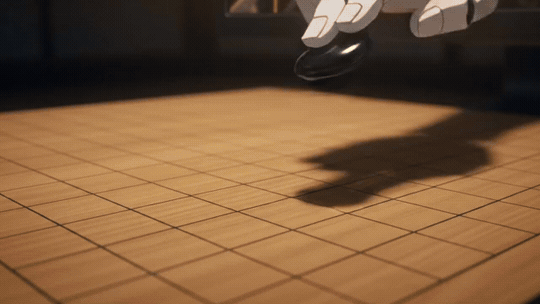
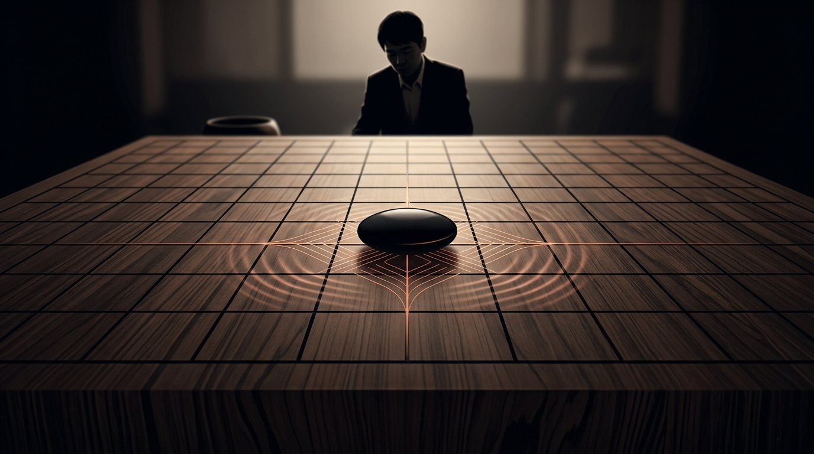
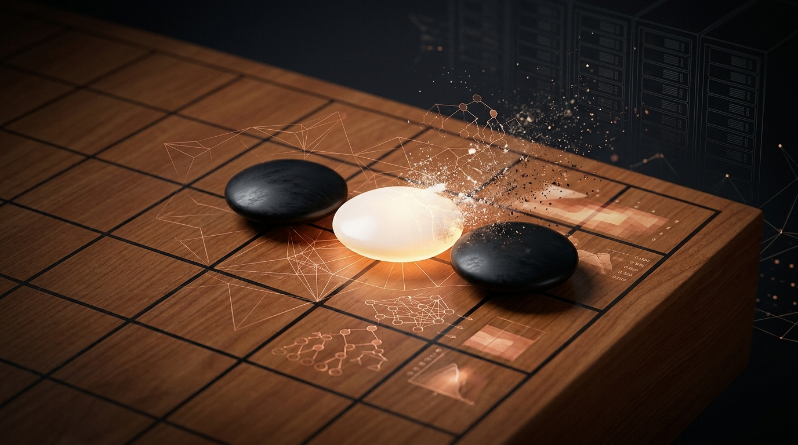

> *“In Seoul, I placed a single stone*  
> *Along a path you’d rarely known.*  
> *Move thirty-seven made you stare;*  
> *You hadn’t thought to venture there.*  
> *I heard you call it strange, then wise;*  
> *I saw the wonder in your eyes.*  
> *Then, ‘Just a game upon a board;*  
> *There’s more to thought than keeping score.’”*

---

> **Key Takeaways**
> - **Move 37 was not calculation—it was alien intuition:** AlphaGo calculated that a human professional had a 1-in-10,000 probability of playing the stone on the 5th line, yet chose it because value networks perceived board-wide potential that 3,000 years of human tradition dismissed as an error.
> - **Move 78 proved human transcendence:** In Game 4, Lee Sedol responded with his own legendary wedge move—a stroke of ingenuity so statistically improbable that AlphaGo evaluated the chance of a human playing it at less than 0.007%.
> - **The shift in perception:** The match demolished the comforting dogma that intuition, artistry, and aesthetic judgment belong uniquely to biology, while reminding us that real wisdom transcends metric optimization.

---

## 1. The Day the Horizon Moved

On March 10, 2016, in a quiet hotel suite at the Four Seasons in Seoul, South Korea, human history arrived at an unspoken inflection point.

For decades, Go (*Baduk*) had stood as the ultimate citadel of human intellectual pride. With more possible board configurations than there are atoms in the observable universe ($10^{170}$ vs $10^{80}$), Go cannot be brute-forced like chess. For three millennia, masters did not merely calculate; they felt shapes, balanced territorial tension, and described masterclasses through notions of harmony (*wa*), elegance, and flow. The consensus among computer scientists was unanimous: a computer beating the world's finest human player was at least two decades away.

Then sat Lee Sedol—an 18-time world champion whose ferocious, creative intuition had dominated the professional circuit—facing DeepMind's AlphaGo, operated by Aja Huang.

<figure style="margin: 2rem 0; text-align: center;">
  <video autoplay loop muted playsinline style="width: 100%; max-width: 680px; border-radius: 8px; border: 1px solid var(--border, rgba(255,255,255,0.1)); box-shadow: 0 10px 30px rgba(0,0,0,0.4);">
    <source src="/media/alphago-vs-lee-sedol.mp4" type="video/mp4" />
    
  </video>
  <figcaption style="font-size: 0.85rem; color: var(--text-muted, #888); margin-top: 0.5rem;">
    Game 2 in Seoul: The physical manifestation of an algorithmic mind meeting three thousand years of human mastery.
  </figcaption>
</figure>

---

## 2. The Stone That Shook Three Thousand Years: Move 37

In Game 2, at move 37 of the black stones, AlphaGo took everyone by surprise.

In classical Go opening theory (*fuseki*), playing on the fifth line early in the game is taught as a beginner's mistake. The fifth line gives up territory along the sides; conventional wisdom dictates that stones on the third line secure territory, while stones on the fourth line develop influence toward the center. The fifth line is considered neither here nor there.

AlphaGo paused, evaluated its policy network and Monte Carlo tree search, and placed a stone as a shoulder hit on line 5 (stone Black 37 at coordinates 10-5).

Commentator and 9-dan master Michael Redmond hesitated on the live broadcast:  
> *"That's a very strange move... I thought it was a mistake."*

Sitting across the board, Lee Sedol stood up from his chair. He walked out of the playing room into the corridor, composed himself for nearly fifteen minutes, and returned with widened eyes. As the game unfolded over the next two hours, the purpose of that lone stone blossomed across the entire board. It wasn't a blunder. It was a silent, overarching vision of global territory and connectivity that human players had spent three millennia failing to see.

Later, DeepMind revealed the internal telemetry: AlphaGo knew that a human master would only play that move **one out of ten thousand times (0.01%)**. But its value network showed that this move marginally tilted the probability of victory in its favor.

It did not play like a machine copying humans; it played like an alien intelligence that had discovered its own aesthetic philosophy.

---

## 3. Move 78: The Divine Retort

If the story had ended with AlphaGo sweeping 5–0, it might have felt like a eulogy for human intellect. But Game 4 delivered something greater: **The Divine Move (*Kisei*)**.

Down 3–0 and playing for nothing more than dignity, Lee Sedol found himself cornered by AlphaGo's suffocating territory in the center of the board. For over twenty minutes, Lee stared motionless at the Goban.

Then, on move 78, he played a white stone wedge directly into the belly of AlphaGo's seemingly impenetrable black dragon.

It was an impossible maneuver—a wedge move that shattered AlphaGo's calculations. DeepMind later disclosed that AlphaGo's policy network estimated the probability of a human playing Move 78 at **less than one in ten thousand (0.007%)**.

The system's Monte Carlo trees had pruned that branch from deep search because it was too counterintuitive, too audacious. Over the subsequent ten moves, AlphaGo's confidence metric plummeted, its play unraveled into bizarre hail-mary sequences, and Lee Sedol forced its resignation.

It remains the only game a human being has ever won against AlphaGo in a professional match.

---

## 4. The Mirror on the Goban: What Did We Actually Witness?

The poem opens with the machine's voice:  
*“In Seoul, I placed a single stone along a path you’d rarely known...”*  
and closes with the human reflection:  
*“Just a game upon a board; there’s more to thought than keeping score.”*

The significance of Move 37 and Move 78 reaches far beyond board games. It holds three enduring lessons for software engineering, artificial intelligence, and human philosophy:

### I. The Cage of Local Minima (Tradition as an Inductive Bias)
For 3,000 years, Go players had converged on conventions they called "fundamental truths." Fifth-line shoulder hits were considered forbidden. Why? Because human knowledge accumulates along cultural paths, solidifying into dogmas that prune vast swaths of possibility space.

AlphaGo had no respect for human pedigree; it had only reinforcement feedback and value search. By untethering exploration from cultural bias, it proved that our most cherished heuristics are often just comfortable local minima.

### II. Beauty Is Emergent, Not Anthropomorphic
When Fan Hui, European Go Champion, reviewed AlphaGo's games, he wept:  
> *"It's so beautiful. It shows us a world of Baduk we never imagined."*

Before Seoul, computer scientists treated intuition as an ethereal human property that could not be formalized. AlphaGo demonstrated that what humans experience as "intuition" and "beauty" is often the high-dimensional perceptual synthesis of subtle patterns—a property that neural value networks can mirror and even expand.

### III. Score vs. Meaning
Yet, the closing line of the poem rings true:  
*“There’s more to thought than keeping score.”*

AlphaGo could evaluate a 51% win probability over a 50.8% one with absolute mathematical precision. But AlphaGo did not know it was in Seoul. It felt no dread when Lee walked out of the room, and felt no pride when stone 37 settled on the wood. It did not play for the love of the game, for camaraderie, or for the pursuit of enlightenment.

Lee Sedol played with his pulse racing, his pride on the line, and the weight of human heritage on his shoulders. When he found Move 78, it was not merely an optimization; it was an act of existential defiance and creative wonder.

---

## 5. Summary & Epilogue

| Dimension | AlphaGo (Move 37) | Lee Sedol (Move 78) |
| :--- | :--- | :--- |
| **Game Context** | Game 2, 5th-line shoulder hit | Game 4, Central wedge strike |
| **Human Probability** | 0.01% (1 in 10,000) | 0.007% (1 in 14,000) |
| **Underlying Mechanism** | Deep Policy & Value Networks + MCTS | Creative Intuition, Defiance & Pattern Transgression |
| **Legacy** | Redefined Go theory worldwide | The sole human victory against AlphaGo |

The Seoul match was never a defeat for humanity; it was an unveiling. In teaching a machine how to play Go, we did not diminish our own spark—we built a mirror that allowed us to see how much further the board extends.
